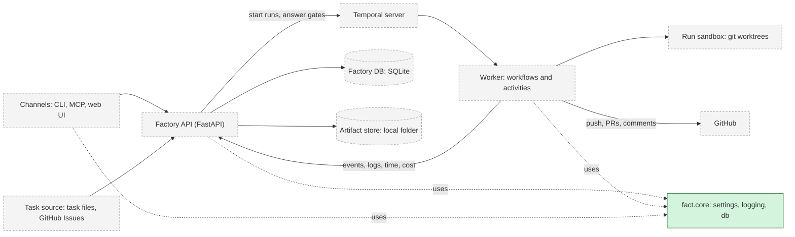
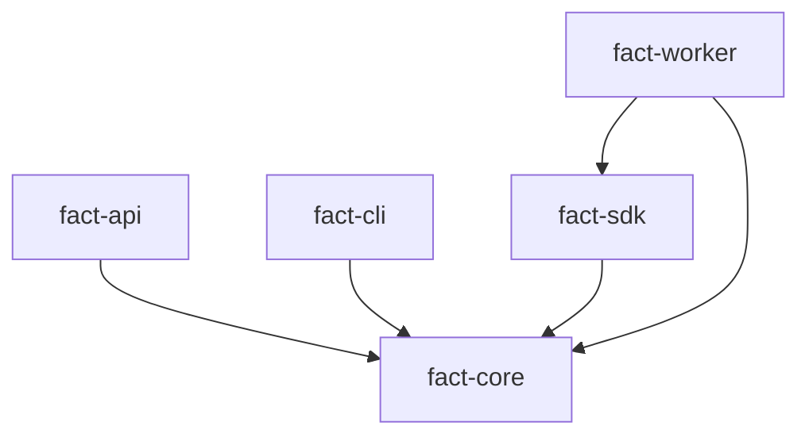

# Architecture

fact is a software factory: a service that turns tracker issues into reviewed GitHub PRs using coding agents, with Temporal running every workflow durably. The design source of truth is `docs/spec/` (start at `docs/spec/README.md`); this file is the index of what exists in code today and how it maps to the design.

**Status (M1 in progress).** `fact.core` has real code: settings (`@core/src/fact/core/settings.py`), structured logging (`@core/src/fact/core/logging.py`) and the async SQLAlchemy layer with Alembic migrations (`@core/src/fact/core/db.py`, `migrate.py`, `@core/migrations/`; schema in `models.py`). `fact.api` has a skeleton (M0-08, see below). `fact.worker` has a skeleton (M0-09): `python -m fact.worker` runs the workers (`client.py`, `__main__.py`). `fact.cli` (M0-10) has the `fact` command: `fact dev` starts Temporal, the API and the worker; `fact projects list` reads the API; `fact github check` verifies GitHub App access. `fact.core.github` (M1-10) mints per-repository GitHub App installation tokens; the worker's `open_change_set` (M1-11) uses them to push the run's branch and open its PR. `fact.sdk` (M1-12) has the workflow base class `FactWorkflow` and the stage manifest; `.fact/workflows/standard.py` is the first project workflow (`Standard`). Since M1-13, `python -m fact.worker` loads each registered project's workflows from a pinned checkout of its home repository and runs them on a versioned `wf-<project>` worker (pinned runs). Since M1-14, `POST /api/v1/runs/start` starts a project's workflow for a task, and `fact run`, `fact runs` and `fact status` start and follow runs through the API. Since M1-15, `fact use <ref>` pins a checkout of the factory and `fact dev --pinned` runs the API and worker from it, so fact can work on itself (spec `14-dogfooding-and-safety.md`). Since M1-19, `Standard` waits for CI on its PR (`wait_for_ci`) and sends failures to `fix_ci` sessions. Since M2-01, a workflow can wait for a person: `FactWorkflow.gate` opens a gate answered through the `answer_gate` update, `status` is a query and `steer` a signal; `Standard` opens a `needs_human` gate when its checks or CI loop is exhausted. Since M2-02, the API and `fact gate`, `fact steer` and `fact status` answer gates, steer runs and show the open gate. Since M2-03, workflows create notifications through the `notify` control activity (a gate opening, PRs ready, a run ending badly), stored in the `notifications` table, served by `/api/v1/notifications` and listed by `fact inbox` until the M4 Inbox. Since M2-04, a run can start with an `approve_plan` gate (`require_plan_approval`); rejecting it ends the run `stopped`. Since M2-05, once CI is green `Standard` notifies `prs_ready` and keeps the run open (stage `wait_for_review`) until its PRs are merged or closed, and ends `merged` or `closed`; since #94 that wait follows GitHub's review flow (`until_reviewed`, the `wait_for_review` control activity): an approval on the PR's head merges it, a review requesting changes gets a `review_reply` round through `converse`. Since M2-06, `fact stop` (`POST /api/v1/runs/{id}/stop`) cancels a run's workflow; `FactWorkflow` handles the cancellation (`fact.sdk.stop`), writes a handoff note (`write_handoff`), tears the workspace down and ends `stopped`, keeping the branch and PR, and the next `fact run` of the task resumes that branch and PR and gets the note as `$handoff`. Since M2-07, a scheduler starts ready tasks by itself through `POST /api/v1/runs/start` in dependency order within `concurrency.max_runs` and each project's `max_runs`; since #55 its tick runs in the API (`run_tick`), not as a Temporal workflow: a loop in dev, `POST /api/v1/scheduler/tick` everywhere; `fact scheduler on|off|status` controls it in dev. Since M2-09, a project whose `task_source.kind` is `github` reads its tasks from GitHub Issues (`GitHubIssuesSource`: open `fact:ready` issues, keys `gh:owner/repo#n`), so `fact run` and the scheduler start issue tasks too; fact's own project still uses task files. Since M2-11, `FactWorkflow` reports run events to the task's source through the `report_status` control activity (`fact.sdk.task_status`), and the GitHub Issues source writes them back: `fact:running`/`fact:needs-human` labels, comments with the run and PR links, closing the issue when the change set merges. Since M2-13, an agent step the Claude usage limit refuses ends `rate_limited`; `FactWorkflow.agent` (`fact.sdk.agents`) marks the run `waiting` (`record_run_waiting`), sleeps on a durable timer until the window resets and resumes the same session, and every agent step records the usage windows it saw through `PUT /api/v1/usage/claude` (table `usage_windows`, listed by `GET /api/v1/usage`). Since M2-14, the scheduler retries a task whose runs failed until `concurrency.max_failed_runs` in a row, starts nothing while a Claude usage window is inside its reserve (the usage gate), previews its next tick in `fact scheduler status`, and the worker keeps Windows awake while runs are active; the task-loop script and the file-task skills are gone. Since #58, tasks have a priority (`priority:*` labels, or `priority:` in a task file; default `medium`): the scheduler orders each project's ready tasks by effective priority, then depth, then id, and the projects take turns for the shared `concurrency.max_runs`. Everything else below marked *planned* is specified in `docs/spec/` and tracked in `tasks/`, but not implemented.

## System Overview

Target architecture (from `docs/spec/04-architecture.md`). Solid boxes exist in code; dashed boxes are planned.



## Package Dependencies (from each `pyproject.toml`)

All packages share the `fact.*` namespace and are members of one uv workspace (`@pyproject.toml`). Dependencies point inward to `core`.



## Component Map

| Component | Path | State | Responsibility |
| --- | --- | --- | --- |
| fact.core | `@core/src/fact/core/` | Partial: `settings.py`, `logging.py`, `db.py`, `models.py`, `enums.py`, `migrate.py`, `migrations/`, `project_config.py`, `types.py`, `activity_contract.py`, `classification.py` (`ClassifySignal`, `Classification`), `gates.py`, `scheduler.py`, `usage_gate.py`, `step_defaults.py`, `tasks/`, `artifacts.py`, `claude_usage.py`, `github/` | Factory settings loading (`settings.py`), a project's step-limit overrides (`step_defaults.py`, in `ProjectConfig`), the scheduler's contract (`scheduler.py`: `SCHEDULE_ID` = `fact-scheduler` (the retired Schedule), `ReadyTasks`, `Hold`, `RunRecord`, `TickResult`, and the pure `run_history_hold`, `effective_priorities`, `plan` and `plan_starts`, see below), the usage gate's models (`usage_gate.py`: `GateState` ok/full/unavailable/off, `GateWindow`, `UsageCheck`, per-window `reserves`/`thresholds`), logging, async DB engine and Alembic, DB models (projects, repositories, runs, steps, events, notifications, usage windows), status/outcome enums, `RunTrigger` (`manual`, `scheduler`) and `NotificationKind` (`gate_waiting`, `prs_ready`, `run_failed`, `run_finished`), the activity contract between `fact.sdk` and the worker (`activity_contract.py`: `CONTROL_QUEUE`/`SANDBOX_QUEUE`, `workflow_queue(project)` giving `wf-<project>`, activity names, activity input models, including `GateOpenedInput`/`GateAnsweredInput`, `NotifyInput`, `WaitForPRClosedInput`, `HandoffInput`/`HandoffStep`, `ReportStatusInput` and `PRState` = `merged`/`closed`), the workflow's person-facing handlers (`gates.py`: handler names `ANSWER_GATE` = `answer_gate` (update), `STATUS` = `status` (query), `STEER` = `steer` (signal), so the API and CLI call them by name without importing `fact.sdk`; `GateDecision` approve/reject, `GateAnswer` (`gate_id`, `decision`, `note` up to 4000 chars), `OpenGate`, `StageOutcome`, `WorkflowStatus`, `STEER_MAX_CHARS` 8000; re-exported from `fact.sdk.types`), shared Temporal-boundary types (`Task` with its `priority`, `Priority` and `PRIORITIES` highest first, `StepResult`, `RunInput` with `home_repo`, the project's `routing: RoutingConfig` and `step_defaults` overrides, `require_plan_approval` (default false) and `handoff_ref` (default None), `Route`, `RouteOverride`, `RoutingConfig`, `DEFAULT_ROUTE`, ..., `limit_text`; frozen Pydantic models carrying `ArtifactRef`s, never raw logs), task sources (`tasks/`: `TaskSource` protocol, `source_for`, `FileTaskSource`, `GitHubIssuesSource` with its write-backs in `github_writes.py`, `events.py`), artifact store (`artifacts.py`: `ArtifactStore` protocol, `LocalArtifactStore` with atomic writes via `.tmp/`, `step_key`, `handoff_key` = `runs/<run_id>/handoff.md`), Claude Code usage windows (`claude_usage.py`: `ClaudeUsage`/`UsageWindow` with `blocked(threshold)`, `full(thresholds)` (per-window thresholds, for the usage gate) and `resume_at(threshold)`, `fetch_claude_usage(token)` for the usage endpoint, `parse_rate_limit_info` for stream-json `rate_limit_event`s, `LIMIT_TEXT_RE` for a usage-limit error result; the token is passed in, `read_cli_token()` is local-dev only), GitHub App access (`github/`, see below) |
| fact.api | `@api/src/fact/api/` | Partial: `app.py`, `projects.py`, `middleware.py`, `deps.py`, `schemas.py`, `run_schemas.py`, `run_totals.py`, `run_start.py`, `run_counts.py`, `task_ref.py`, `scheduler.py`, `scheduler_loop.py`, `usage_gate.py`, `temporal.py`, `routers/`, `__main__.py` | FastAPI app with `/health`, `/api/v1/projects`, the runs, steps and events API, starting runs in Temporal (`POST /api/v1/runs/start`), answering gates, steering, live status and stopping runs (`routers/human.py`), notifications (`routers/notifications.py`), subscription usage windows (`routers/usage.py`), and the scheduler's tick, preview, active-run count, state and dev on/off switch (`routers/scheduler.py`); later logs and costs |
| fact.worker | `@worker/src/fact/worker/` | Partial | Temporal workers on the `control` and `sandbox` queues, plus one workflow worker per registered project on `wf-<project>` (M1-13): `loader.py` (`load_project`: syncs the home mirror, resolves the default-branch SHA, detached worktree at `pinned_dir/projects/<project>/<sha>`, imports `.fact/workflows/*.py` under unique module names `fact_workflows_<project>_<sha12>_<stem>` via a meta path finder; `sandbox_runner()` passes `fact`, `pydantic`, `pydantic_core`, `rich` through the sandbox; a project that fails to load is logged as `workflow_load_failed` and skipped) and `deployments.py` (Worker Deployment Versioning: deployment `wf-<project>`, build id `<factory SHA[:12]>+<home SHA>`, default behaviour `PINNED`, made current on start); the workspace workers of every project version share one cap of `concurrency.sandboxes` concurrent activities (`PoolSlots`); two projects with one build id fail startup (`DuplicateVersionError`). Connect (Pydantic data converter); `activity_workers.py` (each project version's `control` and workspace activity workers, every activity on the queue of its spec's zone, versioned like the project's workflow worker so a pinned run's activities run on its build) and `heartbeats.py` (`HeartbeatInterceptor` heartbeats every activity every 30 s with the details it `report`s); `reporting.py` has `StepReporter`, the context manager activities use to report a step (creates the step, binds logs, uploads `output.log`, patches outcome and usage; API failures never fail the step); `runners/` has the `Runner` protocol (`base.py`: `prepare`, `exec`, `teardown`, `capabilities`; `ExecLine`/`ExecExit` stream items), `LocalWorktreeRunner` (`local_worktree.py`: `prepare` refuses a workspace inside `pinned_dir` or inside the running factory checkout (`factory_root`, default `REPO_ROOT`); bare mirror per repo at `repos_dir/<owner>/<repo>`, synced by the public `sync_mirror`, which also follows default-branch renames with `git remote set-head origin --auto`, one worktree per repo at `workspaces_dir/<run_id>/<repo name>`, `WORKSPACE.md` (renamed into place last, it marks a finished workspace that a retried `prepare` returns), run and mirror file locks on disk (`workspace_files.py`; no in-memory locks), mirror clone, fetch and free-branch pick in `mirror.py` (`Mirror`; clones renamed into place), commit author `fact[bot]` via `GitHubApp.bot_identity()` when the App is configured, else `commit_author_name`/`commit_author_email`; `core.bare` kept in the mirror's `config.worktree`) and `process.py` (spawn with the inherited environment, merged output, process-tree kill on timeout); `activities/workspace.py` (`prepare_workspace`, control queue, awaited until a cancelled attempt has stopped; `teardown_workspace` and `sync_base` on the workspace's queue), `runners/branches.py` (`free_branch`: the task branch, or `<branch>-<n>` when another worktree holds it or, for a suffix, the remote has it), `activities/shell.py` (`shell_step`, runs `.fact/repo.yaml` lint/test commands from the worktree, `passed`/`failed_checks`, on the workspace's queue) and `activities/agent.py` (`agent_step`, the workspace's queue, M1-09: routes harness and model, renders `.fact/prompts/<name>.md` from the home repo worktree (`$handoff` from `handoff_ref`, read through the API, since M2-06), runs the harness at the workspace root, uploads the transcript, passes the step input's `max_turns` and `permission_mode` (the SDK's defaults, 100 and `auto`, under the project's `step_defaults.agent`) and the prompt's output schema (`prompts.BASE_OUTPUT_SCHEMA` plus `.fact/prompts/<name>.schema.json`), and `judge`s the structured answer: `passed` for `status: done`, `needs_human` for `blocked`, `failed_error` without an answer, `stopped_by_monitor` at the turn limit, `rate_limited` (M2-13: outputs `resume_at` and `session_id`) when the usage limit refused the session, whose usage windows it also sends to `PUT /api/v1/usage/claude`; denied tool calls are logged and kept in `outputs.permission_denials`), `activities/change_set.py` (`open_change_set`, control queue, stage `open_pr`, M1-11: one repository in v0, pushes the run's branch with `git_push.py` and opens or reuses its PR with `pull_requests.py`, body from `pr_body.py` and `templates/pr_body.md`; returns `PRRef`s; and `label_change_set`, stage `label_prs`, #13: the classify label and the `## Review` section, the classification in its step outputs), `activities/cost_comment.py` (`post_cost_comment`, control queue, M1-16: reads the run and its steps from the API, renders the cost table with `cost_comment.py` and creates or updates the PR comment marked `<!-- fact:cost -->`; not reported as a step), `activities/ci.py` (`wait_for_ci`, control queue, stage `wait_for_ci`, step kind `github`, M1-19: polls the PR head SHA's check runs and commit statuses through `ci_checks.py` every 30 s until all are complete on two polls in a row, 60 min timeout, passes when no check appears within 5 min; `passed`/`failed_checks`; failed GitHub Actions job logs stored as step artifacts `job-<id>.log`, their last 4 KB in `outputs.failures[].log_tail`), `activities/gates.py` (`GateActivities`, control queue, M2-01: `record_gate_opened` creates the gate's step (kind `gate`; a retry gets the same row back from the API) as `waiting` and moves the run to `waiting`, returning the step id; `record_gate_answered` finishes the step with the outcome, decision, note and `wait_seconds` (its whole wall time, so it counts as human wait, not machine time) and moves the run back to `running`; 4xx non-retryable), `activities/notify.py` (`NotifyActivities`, control queue, M2-03: `notify` POSTs a `NotifyInput` to `/api/v1/notifications` and returns the notification id; idempotent through the API's `dedupe_key`, so retries are safe; 4xx non-retryable; not reported as a step), `activities/review_wait.py` (`ReviewWaitActivities`, control queue, #94: `wait_for_review` reads each still-open PR and its reviews every 60 s and returns the first event per PR, `merged`, `closed`, `approved` on its head or an unhandled `changes_requested` submitted since the run started, picked by `reviews.py` `review_event`; a transient GitHub error skips a poll, 401/404/422 or a missing GitHub App fail it non-retryably; not reported as a step, the workflow records the wait), `activities/conversation.py` (`ConversationActivities`, control queue, #94: `collect_comments`, `post_replies` as `fact[bot]` in-thread or on the PR, never resolving threads, and `request_review`), `activities/merge.py` (`MergeActivities`, control queue: `merge_change_set` skips a PR GitHub already shows as merged (a retried attempt, or an earlier round), then merges each PR with `PUT /repos/{repo}/pulls/{number}/merge` at its `head_sha` with the given method; a refusal (405, 409, 422) stops the rest and returns `out_of_date` when the PR's `mergeable_state` (`pull_requests.merge_state`, asked again while GitHub still computes it) is `dirty` or `behind`, else `refused`; 401/404 or a missing App fail non-retryably; not reported as a step; before each merge it checks the PR's head is still the SHA CI passed on and every check there is complete and passing, else `refused` without merging; used by `Standard` for a change set routed `auto_merge`), `activities/handoff.py` (`HandoffActivities`, control queue, M2-06: `write_handoff` renders a stopped run's note with `handoff.py` `render_handoff` and stores it through `PUT /api/v1/artifacts/<handoff_key>`; not reported as a step), `scheduler.py` (#55: `delete_leftover_schedule`, run at worker start, deletes the retired `fact-scheduler` Temporal Schedule; see "The scheduler" below), `keep_awake.py` (M2-14: `KeepAwake` and `watch_active_runs`, Windows keep-awake while runs are active), `activities/control.py` (`ControlActivities`, control queue, M1-12: `mark_task_done` deletes the task file and commits that on the run's branch (returns False for an issue task, which the `merged` event closes), `record_run_started`/`record_run_finished` PATCH the run, `record_run_waiting` marks it `waiting` or `running` around a usage-limit sleep (M2-13), `record_run_started` also `worker_version` and `home_sha`; not reported as steps), `activities/classify.py` (`classify_signals`, control queue, #12: review signals from the change set's paths, the API snapshot's diff and the task's state, with no LLM; see `@worker/README.md`), `activities/task_status.py` (`report_status`, control queue, M2-08: applies a `TaskEvent` to the project's `TaskSource` through `events.report`; sent by `FactWorkflow.report_task` since M2-11; skipped with a `task_source_unavailable` warning when a `github` project's App is not configured; a GitHub 4xx other than 429 is non-retryable, 429 and 5xx retry under `INFRA_RETRY`); worker modules re-export the contract names from `fact.core.activity_contract`; `routing.py` (`choose`: per-field harness/model from override, then the run's project `routing.rules`, then `routing.default`, carried on `AgentStepInput.routing`); `prompts.py` (`string.Template` prompt rendering, `PromptError`); `python -m fact.worker` runs both activity queues and the project workflow workers, then waits in `watch_active_runs` (the keep-awake poll) until stopped, reaches the API at `settings.api_url`, and on Windows treats Ctrl-Break (SIGBREAK) like Ctrl-C so workers drain; it takes the process's `GitHubApp` from `shared_app` when configured. Details in `@worker/README.md` |
| fact.worker harnesses | `@worker/src/fact/worker/harnesses/` | Partial: `base.py`, `claude_code.py`, `claude_code_usage.py` (`StreamUsage`: tokens summed from stream `assistant` messages for a session cut short), `__main__.py` | Harness contract (`HarnessRequest` with `permission_mode` and `output_schema`, `HarnessResult` with `Usage`, `structured_output` and `permission_denials`, `Harness` protocol `run(request, transcript_path, on_message)`, `HarnessError`) and `ClaudeCodeHarness` (M1-08): runs `claude -p --output-format stream-json --verbose --permission-prompts none` (plus `--permission-mode`, `--json-schema` when set) with the prompt on stdin, writes every output line to the transcript, and reads the result from the final `result` message; spawned through `runners/process.py` (`spawn` options `pipe_stdin`, `merge_stderr`, `limit`). Called by `agent_step`; `python -m fact.worker` registers `ClaudeCodeHarness`. Details in `@worker/README.md` |
| fact.sdk | `@sdk/src/fact/sdk/` | Partial: `types.py` (re-exports `fact.core.types`, enums, `Check`, `CheckResult`), `workflow.py`, `agents.py` (`AgentSteps`, the agent session mixin of `FactWorkflow`: `agent`, resumes, usage-limit pauses), `stages.py`, `sessions.py`, `failures.py` (`failure_context`, `ci_failure_context`, `CONTEXT_MAX_BYTES`; `failure_context` re-exported from `workflow.py`), `pull_requests.py` (`PullRequestSteps`, the PR and CI helpers mixed into `FactWorkflow`), `review_wait.py` (`ReviewWaitSteps`: `until_reviewed`, `wait_for_review`, `review_reply`, `request_review`), `converse.py` (`ConverseSteps`: the `converse` library step), `human.py` (`HumanSteps`, the gate, status, steering and notification mixin of `FactWorkflow`), `stop.py` (`StopSteps`, the stop mixin of `FactWorkflow`), `task_status.py` (`TaskStatusSteps`: `report_task`, `report_run_end`, `mark_task_done`), `activities.py` (`call_activity`, the only `workflow.execute_activity` in `fact.sdk`: schedules an activity from its `ActivitySpec`, on the control queue or the queue `WorkspaceHandle.task_queue` names), `review.py`, `change_set.py`, `classify.py` (`ClassifySteps`, the classify mixin of `FactWorkflow`: `classify`, `label_change_set`), `classification.py` (pure: `decide`, `parse_classify`, `classify_context`) | Workflow base class `FactWorkflow`, `Stage` and `@stages` for project workflows; calls activities by name, never imports `fact.worker`; see below |
| fact.cli | `@cli/src/fact/cli/` | Partial: `main.py`, `dev.py`, `use.py`, `projects.py`, `github.py`, `runs.py`, `inbox.py`, `scheduler.py`, `supervisor.py` | The `fact` Typer command (script entry `fact.cli.main:app`): `--version`, `fact dev [--pinned]`, `fact use`, `fact projects list`, `fact github check`, `fact github labels sync`, `fact run`, `fact runs`, `fact status`, `fact gate`, `fact steer`, `fact stop`, `fact inbox`, `fact scheduler`; see below |
| web | `web/` | Absent | React UI, from M4 |
| `.fact/` | `.fact/` | Partial: `project.yaml`, `repo.yaml`, `workflows/` (`standard.py`, `README.md`), `prompts/` (`implement.md` + `implement.schema.json`, `fix_checks.md` + schema, `review.md` + `review.schema.json`, `address_review.md` + schema, `learn.md` + `learn.schema.json`, `fix_ci.md` + schema, `README.md`) | fact's own project config, workflows and prompts; prompts are rendered by `agent_step` |
| fact.yaml | `@fact.yaml` | Exists | Global settings and project registry (one project: `fact`, home `Kahncode/fact`) |
| scripts | `scripts/` | Exists | Python dev scripts; today only `scripts/tests/` (tests for the `.claude/hooks` scripts). The task loop was retired in M2-14: run every ready task with `fact dev` (the scheduler is on at every API start in dev). Every script is Python |
| Agent tooling | `.agents/` | Exists | Canonical skills (`.agents/skills/`) and subagent definitions (`.agents/agents/`); the SessionStart hook `@.claude/hooks/project_dot_agents.py` projects them into the gitignored `.claude/skills` and `.claude/agents` (see `docs/decisions.md`) |
| CI | `@.github/workflows/ci.yaml` | Exists | On push to main and PRs: `uv sync --locked`, ruff, black `--check`, `lint-imports`, pytest (20 min step timeout); PRs on ubuntu, main on ubuntu and windows |
| Work items | GitHub issues on `Kahncode/fact`, `tasks/` | Exists | fact's work is `fact:ready` issues since M2-12; `tasks/` keeps `backlog.md`, `README.md` (the task-file format for `task_source: files` projects) and the last bootstrap file task, M2-14 |
| Design spec | `docs/spec/` | Exists | Design, one file per section |

## What exists in `fact.core`

**Settings** (`get_settings()`, frozen pydantic-settings `Settings`):

- Source priority, low to high: field defaults, `fact.yaml`, `fact.<env>.yaml`, `.env`, `FACT_*` env vars with `__` nesting.
- `FACT_CONFIG` relocates `fact.yaml`; `.env` is read from the same folder. `FACT_ENV` (`local`, `test`, `dev`, `prod`) selects the overlay file.
- `${VAR}` in YAML expands from the environment, else from the contents of a file at that path (mounted secret); unresolved references are left as written.
- Top-level keys: `env`, `log_level` (optional; `FACT_LOG_LEVEL`; one of DEBUG, INFO, WARNING, ERROR, CRITICAL, case-insensitive), `log_gcp` (bool), `data_dir`, `commit_author_name`, `commit_author_email`, `github_app_id` (str: App ID or Client ID; `FACT_GITHUB_APP_ID`), `github_app_private_key_path` (`FACT_GITHUB_APP_PRIVATE_KEY_PATH`), `github_api_url` (default `https://api.github.com`). `effective_log_level`: `log_level`, else DEBUG for `local`/`dev` and INFO for `test`/`prod`. `is_dev_environment()` is true for `local`, `test`, `dev`.
- Sections: `temporal` (address, namespace, `ui_url` for run links, default `http://localhost:8233`), `api` (host, port), `concurrency` (sandboxes, planners, `max_runs` default 2, `scheduler_interval_seconds` default 30 (the dev tick loop), `max_failed_runs` default 3), `claude` (`usage_gate` default true; `reserve.five_hour` 0.10 and `reserve.weekly` 0.05, the share of each window left to the person), `worker` (`keep_awake` default true), `projects` (the registry: name, home, optional local path). Only factory settings: routing, step limits and the per-project cap are project config (`.fact/project.yaml`, below). Derived paths under `data_dir` (default `~/.fact`): `fact.db`, `temporal.db`, `artifacts/`, `workspaces/`, `repos/`, `pinned/`.
- `api_url` is the base URL clients (worker, CLI) use to reach the API: `http://<api.host>:<api.port>`, with wildcard bind hosts `0.0.0.0` and `::` mapped to `127.0.0.1` and `::1`, and IPv6 literals bracketed.
- `project_path(ref)` gives a project's local checkout (`projects[].path`; a relative path resolves against the folder of `fact.yaml`), or None without one. The API and the worker's `report_status` use it.
- `override_settings_class()` lets an app load a `Settings` subclass once, before first use; `reset_settings()` is for tests.

**Logging** (structlog over stdlib logging):

- `configure_logging(env, level, *, gcp=False, extra_processors=())` once at process start (the API calls it in `create_app`); console renderer for `local`/`test` (colored when stdout is a TTY), JSON otherwise, to stdout. Safe to call again; the last call wins.
- JSON lines add the call site (file, function, line), decode bytes, and honor level filtering (`filter_by_level`). With `gcp=True`, `format_gcloud_logs` (`@core/src/fact/core/logging_gcp.py`) renames `event`/`level` to `message`/`severity` and folds `http_request`/`http_response` into `httpRequest` (method, url, status, latency, user agent, request size); bodies, query and headers stay as top-level `request_body`, `response_body`, `request_query` and `request_headers`.
- stdlib records (uvicorn, temporalio) pass through the same processors.
- `bind_run(run_id, step_id)` context manager binds ids to every line in scope.

**Database** (`db.py`, `migrate.py`, `core/migrations/`; see `@core/README.md`):

- `Base` with a constraint naming convention, `database_url(settings)`, `create_engine(url)` (pragmas `foreign_keys=ON`, `journal_mode=WAL`), `session_factory(engine)`.
- `models.py`: `Project`, `Repository`, `Run`, `Step`, `Event`, `Notification` (typed `Mapped[...]`, portable types only; enums in `enums.py` stored as strings). Run and step ids are uuid4 hex strings, the others integers. The initial Alembic revision creates the first five; a second revision (`..._notifications.py`) adds `notifications` (`run_id` nullable FK to `runs`, indexed; `kind`, `title` up to 300 chars, `body`, `link`, `created_at`, `read_at`, `dedupe_key` unique, up to 300 chars). A third (`..._usage_windows.py`, M2-13) adds `usage_windows` (`account`, `window`, unique together; `utilization` 0..1, `resets_at`, `updated_at`), the last state an agent step saw of each subscription window. A fourth (`..._run_trigger.py`, M2-14, revision `a7c3e91b2d40`) adds `runs.trigger` (`RunTrigger`: `manual` for `fact run`, `scheduler` for the scheduler's starts; existing runs become `manual`). A fifth (`..._stopped_outcome.py`, #8, revision `b8d4f02c3e51`) rewrites stored `dropped` run and step outcomes to `stopped` (the downgrade turns them back). A sixth (`..._usage_detail.py`, revision `c5e1a7d93f20`) adds `cache_read_tokens` and `cache_write_tokens` to runs and steps, `steps.usage_partial`, `runs.cost_unknown_steps`, and makes `steps.cost_usd` nullable (stored 0 of steps without a harness become NULL). A seventh (`..._step_name.py`, #53, revision `d6f2b8a04e31`) adds the nullable `steps.name` (up to 100 chars), which tells apart steps of one stage: a shell step's check (`lint`, or `lint (<owner/repo>)` in a run with several repositories), an agent step's prompt name (`implement`, `fix_checks`); NULL for gate and GitHub steps.
- Alembic with an async `env.py` (URL from settings, `render_as_batch=True`); `migrate.upgrade(url)` runs `upgrade head` in code and creates a missing data dir.

**Project config** (`project_config.py`; fact's own files are in `@.fact/`):

- `load_project_config(home_path)` reads `<home>/.fact/project.yaml` into `ProjectConfig` (name, repositories, task source, runner pool, budget, merge policy, plan approval, workflows map with `default`, `max_runs` (the project's scheduler cap, default 1), `routing` (`default` `Route`, default `DEFAULT_ROUTE` `claude-code`/`sonnet`; `rules` keyed `<complexity|*>.<stage|*>`, each a `RouteOverride`) and `step_defaults` (per kind, `agent`: `timeout_minutes`, `max_turns`, `permission_mode`; `shell`: `timeout_minutes`; every value unset unless the project sets it, filled from `fact.sdk.step_defaults.SDK_STEP_DEFAULTS` (agent 60 min, 100 turns, `auto`; shell 15 min) by `resolve` in the workflow)); `load_repo_config(repo_path)` reads `.fact/repo.yaml` into `RepoConfig` (`setup`, `lint`, `test`, `build`, each a list of argv lists).
- Models are frozen and reject unknown keys; failures raise `ConfigError` naming the file and field.

**Task source interface** (`@core/src/fact/core/tasks/base.py`, `events.py`; tests in `@core/tests/test_task_source.py`): `TaskSource` protocol (async `list_ready(include_waiting=False, close_parents=False)` returning `ReadyItem`s with `depth`, `waiting_on` (the dependencies not done) and `gated_by` (the nearest ancestor not ready), held items listed only with `include_waiting`; `not_ready_ancestor(key)` (always None for file tasks); `get`, `deps_done`, `is_closed` (closed for any reason, or gone), `comment`, `set_labels`, `advance_status(key, TaskStatus)` (forward only, best effort; the file source logs it), `write_context`, `link_prs`, `close`; sync `mark_done`), `parse_key`, `branch_name`, `dependency_key`, and `source_for(project_config, settings, root=None, *, app=None)`, which always returns a source: `FileTaskSource` for `files` (needs `root`), `GitHubIssuesSource` for `github` (with `app`, else the process-wide `shared_app(settings)`; `GitHubAppConfigError` while the App is unconfigured). The API (`fact run`, the scheduler), `mark_task_done` and `report_status` go only through it. `events.report` maps a `TaskEvent` (`run_started`, `gate_opened`, `gate_answered`, `prs_opened`, `merged`, `closed`, `stopped`) to write-backs; `run_started` and `prs_opened` also advance the status to `in_progress` and `in_review` (`TaskStatus`; on GitHub the native issue status, read from the REST issue's `status` and set with the GraphQL `setIssueStatus` mutation, skipped where the repository has none).

**Task files** (`@core/src/fact/core/tasks/files.py`; tests in `@core/tests/test_task_files.py`):

- `FileTaskSource(root, folder="tasks")` reads `tasks/<milestone>/<NN>-<slug>.md` into `Task` models. Implements `TaskSource` (write-backs only log). Sync methods: `all()`, `find(key)`, `status(key)`, `all_deps_done(task)`, `ready()`, `validate() -> list[str]`, `mark_done(worktree, key)`, `depths()` (dependency depth per task key, for the scheduler's order). Only `fact.core.tasks` constructs it (through `source_for`); other code imports it only in tests. The task branch name comes from the module-level `fact.core.tasks.branch_name(key)`.
- The optional front matter field `require_plan_approval` becomes `Task.require_plan_approval` (`None` when absent: the project decides).
- Statuses are not on the `Task` model; read them with `status(key)`. `mark_done` deletes the task's file: a finished file task is removed, not marked (remote sources such as GitHub Issues will mark theirs done).
- A dependency whose file is missing counts as done if its number is below the highest remaining task in its milestone, or its milestone is below the highest milestone present. `validate()` therefore accepts such ids and cannot catch typos below that bound; an id above it (M1-99 when M1-19 is highest) is an error.
- `validate()` on the real `tasks/` folder runs as a test in CI.

**GitHub Issues** (`@core/src/fact/core/tasks/github_issues.py`, M2-09; tests in `@core/tests/test_github_issues.py`, `@api/tests/test_github_tasks.py`): `GitHubIssuesSource(repo, app)` reads one repository's issues with the App's installation token.

- `list_ready()`: open issues labelled `fact:ready`, PRs excluded, whose ancestors are all `fact:ready` and whose dependencies are done (depth always 0); with `include_waiting=True` also those still waiting, with their `waiting_on` and `gated_by` (the nearest ancestor not ready). The type is the first valid `type:*` label other than `type:epic` (which is for people), whatever the label order; `feature` without one. A parent (`sub_issues_summary.total > 0`, closed sub-issues included) with a work type is listed like any task once its sub-issues are closed; a parent without one (`is_parent_without_work`) is never listed, and with `close_parents=True` (only the scheduler's tick, `run_tick`) a ready one under ready ancestors with nothing left to wait on gets a comment and is closed as completed (issues 47, 89). A leaf without a type label runs as `feature`.
- Parents (issue 47; tests in `@core/tests/test_github_parents.py`): `not_ready_ancestor(key)` walks `GET /repos/{o}/{r}/issues/{n}/parent` up to the first ancestor without `fact:ready`. Parent links are cached per instance (one request per issue per tick at most), and listing a parent's sub-issues (`GET .../sub_issues`, skipped when `sub_issues_summary.total` is 0) also records each sub-issue's parent. A parent's open sub-issues join its `depends_on`; closed ones, whatever their close reason, are left out. Pure field parsing lives in `github_fields.py`. `get(key)`: a `Task` for an issue of its own repository, open or closed; None for a PR, an unknown issue, another repository's key or a file key. Task id is the issue number; the branch is `fact/gh-<n>`.
- Type from the `type:*` label (`type:incident` becomes `bug`; unknown or missing: `feature`), complexity from `complexity:*` (default `standard`), priority from `priority:*` (the highest when several; unknown or missing: `medium`), acceptance criteria from the checklist under an "Acceptance criteria" heading of any level.
- `depends_on`: GitHub's blocked-by links (`GET /repos/{o}/{r}/issues/{n}/dependencies/blocked_by`, paginated), then `Depends on #3, owner/other#4` lines, deduplicated, as full `gh:owner/repo#n` keys. A dependency is done when closed as completed, closed with no `state_reason` (older issues), or a merged PR; `not_planned` and `duplicate` are not. An unreadable dependency (404, or the App not installed there) is not done and logs `task_issue_unreadable`.
- Issue payloads are cached per instance: one instance per request or scheduler tick. `mark_done` returns None.
- Write-backs (M2-11, the `GitHubIssueWrites` mixin in `@core/src/fact/core/tasks/github_writes.py`; tests in `@core/tests/test_github_writes.py`) go to the repository the key names, with its installation token: `comment` posts an issue comment; `set_labels` posts the labels to add and deletes each one to remove (a 404 is ignored); `link_prs` posts one comment listing the PRs (none: nothing); `close` patches the issue `closed` with `state_reason` `completed`; `write_context` re-reads the body and patches it only when `with_context` changed it. `with_context` replaces the text between the last `<!-- fact:context:start -->` and the next `<!-- fact:context:end -->`; with no such pair it appends a fresh pair and leaves stray markers; every byte outside the section is kept. A key that is not `gh:` (a file task run on a project whose source is GitHub) is only logged (`task_write_back_skipped`).

**GitHub App** (`@core/src/fact/core/github/`: `app.py`, `client.py`, `labels.py`; details in `@core/README.md`; dependencies `pyjwt[crypto]`, `httpx`):

- `GitHubApp(app_id, private_key, *, api_url, transport, clock)`; `from_settings()` raises `GitHubAppConfigError` if unset and resolves a relative key path from the folder of `fact.yaml`. `app_jwt()` signs RS256 (iat now-60 s, exp now+9 min). `installation_token(owner/repo)` mints a token scoped to that one repository, cached per repository until 5 minutes before expiry, minted once under concurrency. `bot_identity()` gives `<slug>[bot]` and its noreply email. Caches are per instance: one `GitHubApp` per process, obtained with `shared_app(settings)` (cached per App id, key path and API URL; the worker and `source_for` use it).
- `github_client(token, *, api_url)` (or `GitHubApp.api_client(token)` on the App's API URL): `httpx.AsyncClient` with bearer auth and GitHub API headers; errors raise `GitHubAuthError` (401), `GitHubForbiddenError` (403), `GitHubNotFoundError` (404) or `GitHubError`, never carrying headers. Tokens never appear in logs or `repr()`.
- `labels.py`: `FACT_LABELS` (the `fact:*`, `type:*`, `complexity:*` and `priority:*` labels from `docs/spec/12-integrations.md`, each a `Label(name, color, description)`) and `sync_labels(client, owner/repo)`, which creates missing labels and fixes colour, description and case of existing ones (names match case-insensitively), never deletes, and returns a `LabelChange` (created, updated, unchanged) per label. `split_full_name(owner/repo)` (in `app.py`) validates and splits a repository name.
- Used by the worker: `LocalWorktreeRunner` commits as `bot_identity()`, and `open_change_set` pushes and opens PRs with installation tokens (see `@worker/README.md`).

## What exists in `fact.api`

- `create_app(settings=None)` (`@api/src/fact/api/app.py`) builds the FastAPI app. Its lifespan configures logging, runs `migrate.upgrade` in a thread (it starts its own event loop), creates the engine and session factory on `app.state` (`settings`, `engine`, `sessions`), calls `sync_projects`, and disposes the engine on shutdown.
- `sync_projects` (`@api/src/fact/api/projects.py`) upserts each `fact.yaml` project and the repositories from its `.fact/project.yaml` into the DB. It is idempotent and never deletes rows. An invalid or missing `project.yaml` raises `ConfigError` and the API fails to start. A relative project `path` in `fact.yaml` resolves against the folder of `fact.yaml`; a project without `path` gets no repositories.
- Routes: `GET /health` and `GET /api/v1/projects` (`routers/health.py`, `routers/projects.py`; response models in `schemas.py`, dependencies in `deps.py`).
- API compatibility (`openapi_compat.py`, issue 10): `api/openapi.json` is the committed OpenAPI snapshot, written sorted with LF endings by `scripts/openapi_snapshot.py`; `api/tests/test_openapi_compat.py` compares the live schema with it (`compare`): a removed or changed path, method, parameter, property, `required` entry or type is breaking, a newly required field too, and any addition fails until the snapshot is regenerated.
- Runs API (`routers/runs.py`; models in `run_schemas.py`), all under `/api/v1`:
  - `POST /runs` (by project name), `PATCH /runs/{id}`, `GET /runs` (filters `project`, `status`, `task_key`, `workflow_id`; newest first), `GET /runs/{id}` (run plus steps ordered by queued, started, stage, attempt).
  - `POST /runs/{id}/steps` (optional `name`), `PATCH /steps/{id}`, `POST /runs/{id}/events` (batch; a `step_id` must belong to the run).
  - 404 for an unknown run, step or project; 409 for a duplicate `workflow_id`. A new step is `running` if `started_at` is set, else `queued`. Step creation is idempotent: a step posted again with the same run, stage and attempt (an activity retried after its worker died) returns the existing row with 200, restarted (`running` or `queued`, outcome and end cleared) for the retry to finish. A `PATCH /runs/{id}` that leaves the run `finished` ends its steps still `running` as `failed_error` at the run's `ended_at` and recomputes the totals.
  - In PATCH bodies an explicit `null` is ignored for NOT NULL columns; only nullable ones (outcome, timestamps, refs, step outputs) can be cleared.
  - `recompute_totals` (`run_totals.py`) runs on every step PATCH and recomputes the run's `machine_seconds` (step wall time minus `wait_seconds`), `human_wait_seconds`, tokens (`tokens_in`, `tokens_out`, `cache_read_tokens`, `cache_write_tokens`) and `cost_usd` from finished steps only. A step's `cost_usd` is NULL when its harness reported none (steps without a harness, and agent sessions cut short, which set `usage_partial`); `cost_usd` sums the known costs and `cost_unknown_steps` counts the agent steps without one.
- Starting a run (`routers/run_start.py`, `run_start.py`, `task_ref.py`, `temporal.py`): `POST /api/v1/runs/start` with `task_key`, optional `project` and `override_deps`.
  - Finds the project: the one given, else every project with a local `path` (a broken project is skipped with a warning while searching and named in the 404; several matches is 409). `task:` keys match `files` sources, `gh:` keys `github` sources.
  - Opens the source through `source_for` (`project_tasks` in `@api/src/fact/api/task_ref.py`). A `files` source: `git fetch origin <default branch>` (`GIT_TERMINAL_PROMPT=0`; on failure the last fetched state is used), then the task folder from `origin/<default branch>` with `git archive` into a temp dir. A `github` source needs no snapshot; its `GitHubError`/`httpx.HTTPError` (including an unconfigured App) become `TaskReadError`, which is 502 when the project is given. An issue under an ancestor not marked ready gives 409 with `detail.not_ready_ancestor` and unfinished dependencies 409 with `detail.missing_deps`, both unless `override_deps` (issue 47).
  - Workflow type is `workflows.<task type>` from `project.yaml`, else `workflows.default`. Workflow id is `run-<task key, unsafe characters as '-'>-<n>` (e.g. `run-task-M1-02-1`, `run-gh-owner-repo-12-1`), `n` one past the highest used for that task.
  - A task has at most one active run: when it already has a `queued`, `running` or `waiting` run, the start is 409 naming that run's id (`active_run_id`), whoever starts it (#9). A scheduled start (`scheduled: true`) is first checked against `scheduler_refusal`.
  - Inserts the run as `queued`, then starts the workflow on `wf-<project>` with a `RunInput` (repos by `merge_order`, branch `fact/task-<id, lowercased>` or `fact/gh-<n>` from `branch_name`, task complexity, the project's `routing` and `step_defaults`, `run_url` = the Temporal UI link, shown in the PR body, `require_plan_approval` from the task's front matter when set, else `ProjectConfig.require_plan_approval`, default true; fact's own `.fact/project.yaml` sets it false). A failed start keeps the row as `finished`/`failed`; `WorkflowAlreadyStartedError` moves to the next `n` (see `docs/decisions.md`).
  - `RunInput.handoff_ref` (M2-06) comes from `latest_handoff(session, store, project_id, task_key)`: it walks the task's finished runs newest first, skipping runs that never started (failed starts); the first run not `stopped` ends the search (the note is stale); the newest stopped run whose note exists in the artifact store gives its `handoff_key` (a stopped run without a note, such as a rejected plan, is passed over).
  - `scheduled` (M2-14, default false; replaces M2-07's `only_if_never_run`; the scheduler always sends it) re-checks `run_history_hold` (`scheduler_refusal`) and answers 409 when the issue carries `fact:needs-human` (#73), the task has a run in progress, a file task's last run ended other than `failed`, or the task reached the failure cap (unless the tick already held that streak and a person removed the label), and (#55) when `concurrency.max_runs` or the project's `max_runs` is already reached, so the API stays the authority over a stale tick; a start that never reached Temporal (`counts_as_run()` in `run_start.py`) does not count. The run is stored with `trigger` `scheduler`, else `manual`.
  - Returns `run_id`, `workflow_id`, `workflow_type`, `project`, `temporal_url` (`<temporal.ui_url>/namespaces/<ns>/workflows/<id>`).
  - The Temporal client (`app.state.temporal`, a `TemporalConnection`) connects on first use, so the API starts while Temporal is down; an unreachable Temporal is 503, a refused start 502. Refusals (unknown task, missing deps) need no Temporal.
- People in the loop (`routers/human.py`, M2-02), under `/api/v1`, calling the workflow's handlers by name from `fact.core.gates` (never importing `fact.sdk`):
  - `POST /runs/{id}/gates/{gate_id}` (`decision` approve/reject, `note`) runs the `answer_gate` update; `POST /runs/{id}/instructions` (`text`, not blank) sends the `steer` signal. Both return `run_id` and `human_touches`; each success increments `Run.human_touches` with one SQL `UPDATE` (refusals do not count).
  - `GET /runs/{id}/status` runs the `status` query and returns `WorkflowStatus` (stage, attempt, open gate, outcomes, and `waiting`: why the run waits without a gate, such as `usage limit until <time> UTC`).
  - `POST /runs/{id}/stop` (M2-06, body `reason`, optional, up to 4000 chars) cancels the workflow with `handle.cancel(reason=...)` and answers 202 with `run_id` and `human_touches` (one touch). Accepted, not done: the run's own worker version processes the cancellation. 409 when the run row is already `finished`.
  - Errors: 404 unknown run; 409 with the validator's message when the gate is not open; 409 when the workflow is not running in Temporal (`NOT_FOUND`); 503 when no worker answers within `WORKER_TIMEOUT` (8 s, below the CLI's 10 s HTTP timeout); 502 for other Temporal failures or a failed query.
- Notifications (`routers/notifications.py`, M2-03), under `/api/v1`:
  - `POST /notifications` (`run_id` optional, `kind` a `NotificationKind`, `title` 1-300 chars, `body`, `link`, `dedupe_key` 1-300 chars) is idempotent on `dedupe_key`: 201 with the new notification, or 200 with the existing one unchanged (also when a concurrent insert wins the unique constraint). 404 for an unknown `run_id`.
  - `GET /notifications?unread=true&limit=` returns the newest first (by `created_at`, then id); `limit` defaults to 100, max 500.
  - `POST /notifications/{id}/read` sets `read_at` once; reading again keeps the first time. 404 for an unknown id.
- Usage windows (`routers/usage.py`, M2-13), under `/api/v1`: `PUT /usage/{account}` (`account` matches `[a-z0-9_-]{1,50}`; body `windows`: up to 20 of `name`, `utilization` >= 0, `resets_at`) upserts by account and window name, the newest report winning and unmentioned windows kept, and returns that account's rows; `GET /usage` lists every row by account and window. Never a token.
- Scheduler (`routers/scheduler.py`, `scheduler.py`, M2-07, #55), under `/api/v1`: `POST /scheduler/tick` runs one tick (`run_tick`) and returns its `TickResult` (`started`, `failed`, `usage_full`, `skipped` when another tick was running), in every environment; `GET /scheduler/preview` (M2-14) returns `SchedulerPreview` (`plan` over the same `find_ready`, the usage gate's last answer, active and max runs); `GET /scheduler/active` (M2-14) counts runs queued, running or waiting, for keep-awake; `GET /scheduler` returns `SchedulerState` (`in_process`: this API ticks by itself, in dev; `on` and `interval_seconds` in dev, else null; `last_tick_at` and `last_tick` since the API started); `POST /scheduler/on` and `/scheduler/off` (dev only: `dev_router`, not mounted elsewhere, so 404) flip `SchedulerRuntime.on` and return the same state.
- `RequestIdMiddleware` (`middleware.py`, pure ASGI) sets or propagates the `X-Request-ID` header (a supplied value must match `[A-Za-z0-9._-]{1,128}`, else a new UUID in dashed form), binds `request_id` in structlog and logs one `request_completed` line per request: method, path, query, headers without credentials, status, latency, and JSON request and response bodies up to 8 KiB with secret-looking keys masked (`body_capture.py`); `/health` is skipped. Header values, query parameters and JSON keys that look secret are replaced by `***` (`is_secret_key` in `body_capture.py`: a name word of password, secret, token, authorization, credential, signature or cookie, or containing `api_key` or `private_key`; `input_tokens` is not masked). A request cancelled before a response is logged as 499. `unhandled_exception_handler` returns a JSON 500 with `request_id` (plus `detail` only in local and test) and logs it with the id passed explicitly, because it runs outside the middleware.
- Logging is configured in `create_app` (before the app is built) from `settings.env`, `settings.effective_log_level` (`FACT_LOG_LEVEL`; default DEBUG in local and dev, INFO elsewhere) and `settings.log_gcp` (Cloud Logging fields: `message`, `severity`, `httpRequest`; `core/src/fact/core/logging_gcp.py`). `python -m fact.api` runs uvicorn with `log_config=None` and `access_log=False` so its lines go through structlog. JSON lines carry the call site.
- `@api/tests/test_routes.py` fails when a route is missing from `TESTED_ROUTES` or lists a test that does not exist; add every new route there.
- Run with `uv run python -m fact.api`: uvicorn on `settings.api.host` and `settings.api.port`. Tests: `@api/tests/test_app.py`, `@api/tests/test_runs.py`, `@api/tests/test_run_start.py`, `@api/tests/test_human.py` (time-skipping Temporal with a one-gate workflow), `@api/tests/test_stop.py` (the stop endpoint, the reason reaching `workflow.cancellation_reason()`, `latest_handoff`), `@api/tests/test_notifications.py`, `@api/tests/test_usage.py`, `@api/tests/test_scheduler.py` (ready tasks, which runs keep a task from being offered, the preview), `@api/tests/test_scheduler_tick.py` (`run_tick`: order and caps, refusals, no overlap, the usage gate), `@api/tests/test_scheduler_switch.py` (the dev loop and switch, none in prod), `@api/tests/test_usage_gate.py`; shared fixtures in `@api/tests/conftest.py`, task-repository helpers in `@api/tests/task_repo.py`.

## What exists in `fact.sdk` and `.fact/workflows/`

- `@sdk/src/fact/sdk/workflow.py`: `Stage(id, label, kind, loops_to=None)` and the `@stages([...])` class decorator (rejects duplicate ids and unknown `loops_to`), stored as `stage_manifest`; `manifest()` returns plain dicts for the UI.
- `FactWorkflow` helpers: `execute(run_input, body)` records the run started (with the build id from `workflow.info().get_current_deployment_version()` as `worker_version`) and finished (best effort; `failed` when `body` raises a Temporal failure) and calls `teardown_workspace` (best effort) only when the run ends in `PUSHED_OUTCOMES` (`pr_opened`, `merged`, `closed`, `abandoned`); on every ending, stopped included, it then posts the cost comment on `self.prs` (if any) last, through `record_run_end(outcome)` or after the teardown, `prepare()` (once per run; a second call returns the same handle), `setup(stage_id="setup")` (each repository's `.fact/repo.yaml` `setup` commands as shell steps in the sandbox; returns the first step that did not pass, else None), `agent(stage_id, prompt, context, pr_text=True)` (`pr_text=False`: the session's `title`/`summary` are not taken for the PR), `until_green(checks, fix_prompt, max_attempts, stage_id="checks", fix_stage="implement")`, `mark_task_done()`. The PR and CI helpers live in the mixin `PullRequestSteps` (`@sdk/src/fact/sdk/pull_requests.py`): `pr_text()` (agent-written `title`/`summary` outputs, else a conventional title from the task), `open_change_set(title, summary, criteria=())` (`criteria`: `CriterionResult`s from a review, shown as a table in the PR), `push_change_set(criteria=None)` (pushes the same change set again as the next `open_pr` attempt and updates the PR, with a new review's criteria when given; records `pushed_at`), `post_cost_comment(prs)` (best effort; `execute` calls it at the end, a workflow may call it mid-run too), `wait_for_ci(pr)`, `until_ci_green(prs, fix_prompt, max_attempts, stage_id="wait_for_ci", fix_stage="fix_ci")`, `until_reviewed(prs, on_review)` and `wait_for_review(prs)` (in `ReviewWaitSteps`, below), `merge_change_set(prs, method="squash")` (a `MergeResult`: `merged` when every PR merged, which also sets `merged_by_fact` so the run's end notifies no one, `out_of_date` when GitHub refused one whose `mergeable_state` is `dirty` or `behind`, else `refused`; `Standard` calls it once CI is green for a change set routed `auto_merge` when `RunInput.auto_merge` is on, with `RunInput.merge_method`). Keeping the branch up to date lives in the mixin `BaseSyncSteps` (`@sdk/src/fact/sdk/base_sync.py`): `sync_base(stage_id="sync_base", verify_only=False)` runs the `sync_base` activity on the workspace's queue (its spec: 30 min, `INFRA_RETRY`, awaited until a cancelled attempt has stopped), `sync_with_base(fix_prompt="resolve_conflicts", max_attempts=2)` merges the base and, on conflicts, runs a `resolve_conflicts` session with `conflict_context` (the unmerged paths per repository), then `sync_base(verify_only=True)` to check the merge was concluded, without merging a base that moved on meanwhile; it returns `up_to_date`, `merged`, `resolved` (an agent changed code: run the checks again) or `needs_human`, and pushes nothing. `self.prs` holds the PRs at their latest pushed head SHA. The gate, status and steering handlers live in the mixin `HumanSteps` (`@sdk/src/fact/sdk/human.py`); Stopping lives in the mixin `StopSteps` (`@sdk/src/fact/sdk/stop.py`, below); task status reporting and `mark_task_done` in `TaskStatusSteps` (`@sdk/src/fact/sdk/task_status.py`, below). Agent sessions (`agent`, its resumes and usage-limit pauses) live in the mixin `AgentSteps` (`@sdk/src/fact/sdk/agents.py`). `FactWorkflow` is `(AgentSteps, PullRequestSteps, ClassifySteps, BaseSyncSteps, HumanSteps, StopSteps, TaskStatusSteps)`; it and `HumanSteps` call `super().__init__()`, so a subclass defining `__init__` must call `super().__init__()` too.
- Stopping a run (`StopSteps`, M2-06): a stop is a Temporal cancellation of the workflow with a reason; `stop_requested()` is `workflow.cancellation_reason() is not None`. `execute` (which records the run started inside its `try`) catches `FailureError` or `asyncio.CancelledError` and, when a stop was requested, returns `await self.stop()` instead of recording `failed`; the workflow then completes normally, not as Temporal-cancelled. A stop arriving as `body` returns goes through `stop()` too, unless the outcome is in `PUSHED_OUTCOMES`, which records its real outcome. `raise_if_stopped()`, called by `next_attempt` and `_activity`, raises `CancelledError`, so no step starts after a stop even when workflow code swallowed a cancelled activity's error. Once the run's end is under way (`stop()`, `record_run_end`, or `execute` recording a finished `body`'s outcome set `_stopping`), it no longer raises, so a late stop cannot skip the end bookkeeping (outcome, teardown, cost comment). Agent and shell steps use `ActivityCancellationType.WAIT_CANCELLATION_COMPLETED`, so the stop waits until the session or subprocess has stopped (the cancellation reaches the activity at its next heartbeat). `stop()` writes the handoff note with `write_handoff` (`HandoffInput`: `run_id`, `task`, `reason`, the last stage and attempt from `next_attempt`, every agent step as `HandoffStep(stage_id, attempt, outcome, summary)`, `prs`), tears the workspace down, reports `stopped` to the task (M2-11), then records `stopped` last, so a run shown `stopped` already has its note and a free branch; each of the three is best effort. It returns `RunResult(outcome=STOPPED, prs, summary="stopped: <reason>" or "stopped")`. The remote branch and PRs are kept; a restart reuses them through existing mechanics (`LocalWorktreeRunner` gets the unsuffixed task branch, now free, and resumes from `origin/<branch>`; `open_or_update_pr` finds the branch's open PR). Every agent session gets `RunInput.handoff_ref` as `AgentStepInput.handoff_ref`.
- Task status (`TaskStatusSteps`, M2-11): `report_task(event, detail="", prs=())` runs the `report_status` control activity, best effort: on an `ActivityError` it calls `raise_if_stopped()` (a stop that cancelled the report still stops the run), then logs a warning. Senders: `execute` sends `run_started` after recording the start, and `report_run_end(result)` after `record_run_finished`, before teardown (`merged`, `closed`, `stopped` including a rejected plan, `needs_human` or `pr_opened`; `failed` sends nothing), through `report_end`, which also sends one `task_held` notification for every end but `merged` (`fact.core.holds.HELD_ENDS`); `gate()` sends `gate_opened` (detail: the gate's summary and the `fact gate <run> approve|reject` hint) and `gate_answered`; `open_change_set` sends `prs_opened` (not later CI-fix pushes); `stop()` sends `stopped` with the reason (and `task_held`) through `report_end` after teardown, before recording the outcome. The `wait_for_review` wait sends no gate events.
- Gates and steering (`HumanSteps`, names from `fact.core.gates`): `await self.gate(gate_id, kind, details)` opens a gate (unique id per run; its step is stage `kind`, numbered by `next_attempt`), records it with `record_gate_opened`, waits with `workflow.wait_condition` (no timer, no activity: free while open, survives worker restarts), records the answer with `record_gate_answered` and returns the `GateAnswer`. Gate recording is best effort (a failure logs a warning). The `answer_gate` update's validator refuses an unknown gate (`unknown gate 'x'; open gates: ...`) or a closed one (`gate 'x' is already closed: answered approve`), so the caller gets a `WorkflowUpdateFailedError`, never a silent no-op. The `status` query returns the latest stage and attempt (set by `next_attempt`), the open gate and the outcome of every step that ended (agent, shell, `wait_for_ci`, `open_pr`, gate). The `steer(text)` signal queues stripped text; the next agent session gets it appended to its context under `## Additional instructions` (`with_steering`; the newest 8000 chars), then the queue is cleared. A running session is never interrupted.
- Notifications (`HumanSteps`, M2-03): `await self.notify(kind, title, body="", link=None, key="")` runs the `notify` control activity with dedupe key `<run_id>:<key or kind>` (cut to 300 chars; title cut to 300) and link defaulting to `RunInput.run_url`; it is best effort (a failed activity logs a warning). `gate()` notifies `gate_waiting` once per gate (key `gate:<gate_id>`, body the details' `summary` plus the `fact gate <run_id> approve|reject` hint) right after recording it. `notify_prs_ready(prs, body="", reasons=())` sends `prs_ready` (link: the first PR; `reasons`, the classification's, listed under "Why a review"). `notify_run_end(result)` sends `prs_ready` through it for `pr_opened`, `run_failed` for `failed` or `needs_human`, nothing for a `merged` run whose change set fact merged itself (`merged_by_fact`, set by `merge_change_set`), else `run_finished` (`merged` by a person, `closed`, `stopped`); the key is the kind, so one of each per run. `FactWorkflow.execute` does not call it; the workflow does. `NotificationKind` is re-exported from `fact.sdk.types`.
- `until_ci_green`: waits for CI on every PR; on failure a fresh `fix_stage` session gets `ci_failure_context` (each failed job's name, conclusion, link and log tail), then `push_change_set` and wait again. `max_attempts` caps the fix sessions. A `wait_for_ci` result with `outputs.conflict` (the PR conflicts with its base, so GitHub runs no CI) returns `conflict` at once: merging the base is the workflow's job. Returns a `CIOutcome`: `passed`, `conflict`, or `needs_human` when the fixes are exhausted, a fix session does not pass, a fix commits nothing (head SHAs unchanged, logged), or CI timed out (no fix is tried then).
- Review (`ReviewWaitSteps`, `@sdk/src/fact/sdk/review_wait.py`): `until_reviewed(prs, on_review)` waits until every PR is merged or closed (`merged` if all, else `closed`; no PR: `pr_opened`), handing each `approved` and `changes_requested` event to the workflow's `on_review` (None to wait again, or the run's end); a PR fact merged is seen `merged` by the next wait. `wait_for_review(prs)` records one gate-like step per wait (stage and kind `wait_for_review`, step kind `gate`, id `wait_for_review-<attempt>`, details `summary` and `prs`) through `record_gate_opened`/`record_gate_answered`, so the run shows `waiting` and the wait is human wait; `answer_gate` cannot answer it. It runs the `wait_for_review` activity with `handled_reviews`, `reviews_since` (the run's start, so a new run on a reused PR does not answer earlier runs' reviews) and what is left of the run's 30 days (`REVIEW_TIMEOUT`, `LONG_WAIT_RETRY`), adds every review id it returns to `handled_reviews`, and ends its step `passed` when every event is `merged` or `approved`, else `needs_human`, the note listing each event. If the activity fails, the step ends `needs_human` and the error is re-raised (the run fails, workspace kept). `review_reply(event)` runs `converse` (`@sdk/src/fact/sdk/converse.py`: `collect_comments`, a read-only session, `post_replies`, best effort) with prompt `review_reply` and decisions `implement` or `reply`, over comments since the later of the last push (`pushed_at`) and the last round; `rework_context` briefs the implement session; `request_review` is best effort; `notify_merge_refused(event)` tells a person an approved PR did not merge.
- `until_green`: `max_attempts` caps fix sessions, so checks run at most `max_attempts + 1` times; it stops early when a fix session does not pass. Fix sessions are new attempts of `fix_stage`. Attempt numbers are per stage; each shell step in `checks` takes the next one.
- Retries: agent steps are never retried by Temporal (`NO_RETRY`); `FactWorkflow.agent` resumes a session at most once (`fact.sdk.sessions`): when the worker stopped during it (`AGENT_INTERRUPTED`, or a heartbeat timeout whose last heartbeat carries the session id), or when the agent answered `blocked` with `retryable: true`, after a 2 min durable timer. The resume is a new attempt of the stage with `resume_session_id`. No answer, the turn limit or a timeout is never retried; shell and control steps, including `wait_for_ci`, use `INFRA_RETRY` (5 attempts); `wait_for_review` uses `LONG_WAIT_RETRY`. Zones, maximum durations, retries and cancellation are each activity's `ActivitySpec` in `@core/src/fact/core/activity_contract.py`, applied by `@sdk/src/fact/sdk/activities.py`; `HEARTBEAT_TIMEOUT` (2 min) applies to all, and the worker heartbeats every activity (`@worker/src/fact/worker/heartbeats.py`). The agent and shell steps' durations come from `RunInput.step_defaults` (the project's overrides from `.fact/project.yaml`, filled by whoever starts the run) resolved over `SDK_STEP_DEFAULTS` by `fact.sdk.step_defaults.resolve`; workflow code reads no settings.
- `@.fact/workflows/standard.py`: `Standard` (Temporal type `standard`), stages `approve_plan` (kind `gate`), `prepare`, `setup`, `implement`, `checks` (loops to `implement`), `review`, `address_review` (loops to `checks`), `learn`, `open_pr`, `wait_for_ci` (loops to `fix_ci`), `fix_ci` (loops to `open_pr`), `classify` (kind `agent`), `label_prs` (kind `github`), `sync_base` (kind `shell`, "Merge base branch"), `resolve_conflicts` (loops to `sync_base`), `wait_for_review` (kind `gate`, label "Wait for review"), `review_reply` (kind `agent`, loops to `implement`), `needs_human` (kind `gate`). When `RunInput.require_plan_approval` is on, `Standard` first opens gate `approve_plan` (id, kind and stage), before any workspace exists, with details `summary`, `title`, `path` and `acceptance_criteria`: approve goes on; reject ends the run `stopped` with summary `plan rejected: <note>` (the gate step itself ends `needs_human` with the note, as every rejected gate does), with no workspace to tear down, and `notify_run_end` sends `run_finished`. After green checks, one `review` session (routed to opus by `*.review`) answers each acceptance criterion and lists findings; `fact.sdk.review.parse_review` validates them (an invalid answer is `failed_error`). An unmet criterion or a medium/high finding runs `address_review` with `review_context(review)`, then the check loop again (one round in v0). Outcomes: an implement, review or address-review step ending `needs_human` is `needs_human`, any other failure `failed`. When `until_green` (checks, 3 fix sessions) or `until_ci_green` gives up, `Standard` opens a `needs_human` gate with id `<loop>-<n>` (`checks-1`, `wait_for_ci-2`, ...) and details `{loop, summary}`: approve runs that loop once more (steering reaches its fix sessions), reject ends the run `needs_human` with the note appended to the summary (`; rejected: <note>`), with no PR for checks and the PR open for CI. Once checks are green, a `learn` session updates the context docs on the branch and answers the PR `title` and `summary` (a learn session that does not pass, or gives no text, falls back to the implement session's text and never fails the run; fix and address sessions never write the PR text), the task is marked done and the PR opened with the review's criteria table. The base branch is merged into the run's branch only when GitHub says it must be: a PR that conflicts with it (in `until_ci_green`, below) or a merge refused as `out_of_date`; never because it moved on. Then `_ci_loop`: `until_ci_green(prs, "fix_ci", MAX_CI_FIX_ATTEMPTS=2)` with its gate (above); a `conflict` runs `_take_base` (`_synced`, then `push_change_set`) and CI again, at most `MAX_BASE_SYNCS` (2) times before a `needs_human` gate with loop `sync_base` (approve allows as many more); A rejected CI gate is `needs_human` with the PR open (and the workspace kept). Once CI is green and the change set is routed `auto_merge` with `RunInput.auto_merge` on (from the project's `auto_merge`, with `merge_method`, set by `run_input`), `merge_change_set` comes first: `merged` ends the run `merged`, labelled `fact:auto-merge`, with no notification; `out_of_date` runs `_take_base` (`_synced`: `sync_with_base("resolve_conflicts")`, where `resolved` loops the checks with their `checks` gate and `needs_human` opens a gate with loop `sync_base`; then `push_change_set`) and `_ci_loop` again, then merges again, at most `MAX_BASE_SYNCS` (2) times; `refused`, or the cap, relabels the change set `fact:needs-review` (`route_to_review`, the reason added) and falls through to the review wait, as does a change set routed `human_review` or auto-merge off (relabelled too). Then `notify_prs_ready` sends `prs_ready` with the classification's reasons and `until_reviewed` follows GitHub's review flow: an `approved` event runs `_ci_loop` on that PR's head and merges it alone with `merge_method` (a CI fix moves the head, so it needs a new approval; a refused merge notifies `prs_ready` once per review through `notify_merge_refused` and waits), a `changes_requested` event runs `review_reply` (`implement`: the chain again from implement, learn, push to the same PR and CI, never classified; `reply`: nothing pushed) and re-requests review; the run ends `merged` if every PR merged, else `closed`, with summary the PR URLs; `execute` tears the workspace down and posts the cost comment, once, on every ending with a PR. `Standard` no longer ends `pr_opened`. A stop (M2-06) ends it `stopped` through `execute` at any stage. `Standard.run` calls `notify_run_end` with the result, and also when `execute` raises a `FailureError` (as `failed`, with the PRs opened so far) before re-raising.
- Tests: `@worker/tests/test_standard_workflow.py` runs `Standard` in a time-skipping environment against fake activities registered under the real names, and replays the green run's history; review, learn and CI loops are in `test_standard_review.py`, `test_standard_learn.py` and `test_standard_ci.py`; gates (approve with a replay, reject with the status query, unknown and closed gate errors, steering, a several-day wait with no activity or timer) in `test_standard_gates.py`, with `gate_harness.py` (`until_status` polls the status query until a predicate holds, within 30 s, and fails as soon as the workflow closes; `open_gate` also waits until the workflow is idle (last event a completed workflow task), so the gate's opening activities have all run; `answer` sends the update). `FakeActivities.gate_decisions` answers gates from inside the fake `record_gate_opened` (see `docs/decisions.md`). `@sdk/tests/test_human.py` and `@worker/tests/test_gate_activities.py` cover the mixin and the gate activities. `@worker/tests/test_standard_notify.py` checks `Standard`'s notifications: PRs ready on a green run, one per gate then the end, a blocked agent and a failed run, and a failing `notify` that does not fail the run. `@worker/tests/test_standard_plan_approval.py` covers the plan gate: skipped when off, answered before `prepare_workspace` on approve, and a reject that ends `stopped` with no workspace or agent step. `@worker/tests/test_standard_merge.py` covers the review wait (ends `merged`/`closed` with teardown, `prs_ready` before the wait and one cost comment at the end, a failed wait that ends its step and fails the run) and `@worker/tests/test_standard_review_flow.py` the review flow (approval merges, changes requested get one `review_reply` round, `implement` reworks on the same PR), `@worker/tests/test_wait_for_review.py` the `wait_for_review` activity and `@worker/tests/test_conversation.py` the conversation activities against mocked GitHub responses. `@worker/tests/test_standard_stop.py` stops `Standard` at a gate, during the wait for review (PR kept, history replayed) and during an agent session (teardown after the session stopped), and checks a restart passes `handoff_ref` to every agent session; `@worker/tests/test_handoff.py` covers the note and `$handoff`; `test_change_set.py::test_restart_after_a_stop_reuses_the_branch_and_the_pr` checks the restart's branch, start commit and PR with real git and mocked GitHub. `@worker/tests/test_standard_base_sync.py` covers the base merge: none for a mergeable PR, a conflicting PR merged cleanly or resolved by an agent (checks before the push), unresolved conflicts at the `sync_base` gate, a red resolution at the `checks` gate (reject unpushed, approve fixed then pushed), the conflict cap, and an out-of-date merge retried, stuck and capped; `@worker/tests/test_sync_base.py` runs the activity with real git (up to date, a merge commit, a conflict left in progress then concluded without chasing a base that moved on, a dirty worktree, a failed fetch). Shared run input and scripted answers live in `@worker/tests/standard_inputs.py`, the PR, CI, merge and base sync fakes in `@worker/tests/standard_pr_fakes.py` (`FakePRSteps`, the base of `FakeActivities`; `sync_script`, `merge_script`, `ci_conflicts`), result helpers (agent sessions, finished outcomes, checks) in `@worker/tests/standard_results.py` (re-exported by `standard_harness.py`); the fake `report_status` records each event as an activity call; `FakeActivities.pr_state` sets how each PR ends and `FakeActivities.gates(name)` lists gate calls without the review wait.

## What exists in `fact.cli`

- `fact` (`@cli/src/fact/cli/main.py`): Typer app with `--version`, the `dev` and `use` commands and the `projects` and `github` groups. Dependencies: `typer`, `httpx`.
- `fact github check <owner/repo>` (`github.py`): configures logging at WARNING, mints an installation token through `GitHubApp.from_settings()` and prints the app slug and id, installation id and account, and token expiry, never the token. Exits 1 with a readable error on a `GitHubError`, a bad name, a network failure or a 2xx response with an unexpected body (`error: unexpected GitHub response (missing ...)`). `make_app()` is the test seam.
- `fact github labels sync <owner/repo>` (`github.py`): runs `sync_labels` with an installation token for that repository and prints one line per label (`created`, `updated` or `unchanged`) and a summary (`<n> of <total> labels changed on <owner/repo>`); same error handling as `check`.
- `fact projects list` (`projects.py`): `GET /api/v1/projects` at `settings.api_url`, printed as a `NAME`/`HOME`/`REPOSITORIES` table; exits 1 with a message when the API is unreachable or answers an error. `make_client()` is the seam tests replace with an `httpx.MockTransport` client.
- `fact run <task_key> [--force-deps] [--project]`, `fact runs [--project] [--status]` and `fact status <run id | workflow id>` (`runs.py`) call the runs API at `settings.api_url`. `run` prints the workflow id, run id and Temporal UI link, and names missing dependencies or the ancestor not ready on a 409 (another 409, such as the task's active run, prints the API's detail); `runs` prints a table, newest first; `status` resolves a `run-...` id through `GET /runs?workflow_id=`, then prints the run (with `Cost:`, adding how many agent steps have no reported cost, and `Tokens:` with fresh input, cache read, cache write and output) and its steps (`NAME` column after `STAGE`, `-` when null) with durations, outcome, cost (`unknown` for an agent step without one, `(cut short)` for partial usage) and artifact links for logs and transcripts; for a run not finished it adds a `Gate:` line from the status query (the open gate, `none open`, or `unknown (<error>)`) and, while the run waits without a gate, a `Waiting:` line with the query's `waiting` reason (such as `usage limit until <time>`).
- `fact gate <run> approve|reject [--note TEXT] [--gate ID]` and `fact steer <run> TEXT` (`runs.py`) call the gate and instructions endpoints. Without `--gate`, `gate` answers the open gate from the status query, or fails with `has no open gate`; API errors print as `error: API answered <code>: <detail>`. `fact stop <run> [--reason TEXT]` (M2-06) calls the stop endpoint and says the run ends `stopped` once its worker has written the handoff note and removed its workspace; then `fact run` restarts the task. `@cli/tests/test_gate.py` (gates, steering, stop) runs the CLI end to end against the real API app and a time-skipping Temporal. `call_api` and `api_error` in `runs.py` are the shared helpers other command modules use.
- `fact scheduler on|off|status` (`scheduler.py`, M2-07): `POST /api/v1/scheduler/on|off` (dev only; 404 elsewhere, shown as an error) or `GET /api/v1/scheduler`, then prints whether the scheduler is on or off and its interval (dev), or that only `POST /scheduler/tick` ticks, and the last tick. `status` (M2-14) also prints `GET /api/v1/scheduler/preview`: active runs of `max_runs`, the usage gate's last answer (state, each window's utilization, reserve and reset, `FULL` marks, the next check; or `no answer yet`) and the ready tasks in start order with `starts next tick` or `waits (<hold>): <detail>`. `@cli/tests/test_scheduler.py`.
- `fact shutdown` (`shutdown.py`): `POST /api/v1/scheduler/shutdown` (dev only) turns the scheduler off and sets its in-process `shutdown` flag (`POST /scheduler/on` clears it), then prints the active run count. `fact dev`, in every mode, polls `GET /scheduler` and `/scheduler/active` every 5 s (`ShutdownWatch`, inside the `Follower` under `--follow`, which never upgrades while the flag is set) and, once the flag is set and no run is active, raises `StopRequestedError` so the supervisor stops every child and exits 0. `@cli/tests/test_follow.py`, `@cli/tests/test_supervisor.py`.
- `fact inbox [--all]` (`inbox.py`, M2-03): `GET /api/v1/notifications` (`unread=true` unless `--all`) printed as an `ID`/`KIND`/`TITLE`/`CREATED`/`STATE`/`LINK` table, newest first; `fact inbox read <id>` marks one read. `@cli/tests/test_inbox.py` runs it against the real API app through `@cli/tests/api_bridge.py`, the bridge shared with `test_gate.py`.
- `fact dev` (`dev.py`): fails with an install hint if `temporal` is not on PATH, creates `data_dir`, then starts, in order: `temporal server start-dev --db-filename <data_dir>/temporal.db --port <port of temporal.address> --ui-port 8233`, `python -m fact.api`, and `python -m fact.worker` (started only once Temporal's port accepts connections, 60 s timeout). Exit code is 0 on Ctrl-C, else the first child's exit code. With `--pinned`, Temporal runs as before but the API and worker run from the pinned version as `<checkout>/.venv/Scripts/python -m fact.api|fact.worker` (`bin/python` on POSIX; built by `fact use`), with no config override: the checkout reads its own committed `fact.yaml` and the `.env` that `fact use` copied from the source tree; it exits 1 if nothing is pinned or `uv` is not on PATH. In both modes the API and worker start without the venv activation `fact dev` inherited (from `uv run` or a VS Code terminal): `VIRTUAL_ENV` and `VIRTUAL_ENV_PROMPT` are removed and that venv's `Scripts`/`bin` folder is stopped from `PATH`, so workspaces get a plain environment and `uv run` there picks the workspace's own `.venv`.
- `fact use <ref>` (`use.py`): runs `git fetch --prune origin` in the factory source tree, resolves `origin/<ref>` first, then `<ref>` (`HEAD` always means the local HEAD), creates a detached worktree at `<data_dir>/pinned/factory/<sha>` (reused when already at that SHA, recreated when broken), runs `uv sync --locked` in it and writes the SHA to `<data_dir>/pinned/current`. `current_pin(settings)` reads it back for `fact dev --pinned`.
- `supervisor.py` (generic, `run_all(specs)`; each `ChildSpec` may carry an `env` dict of extra variables): each output line is prefixed with the process name. When a child exits (`fact | <name> exited with code N`) or on a stop signal (SIGINT, SIGTERM, plus SIGBREAK on Windows or SIGHUP on POSIX), it stops the children one at a time, last started first, escalating interrupt, terminate, kill with 10 s per step; further stop signals are ignored meanwhile. Each child runs in its own process group (Windows; interrupt is `CTRL_BREAK_EVENT`) or session (POSIX; signals go to the group via `killpg`).

## The scheduler (M2-07, M2-14, #55)

The only background job in fact, in the API process; Temporal runs only project workflows (see `docs/decisions-2.md`). Contract in `@core/src/fact/core/scheduler.py` and `@core/src/fact/core/usage_gate.py`; candidates, tick and preview in `@api/src/fact/api/scheduler.py` (run counts in `run_counts.py`), the dev loop in `@api/src/fact/api/scheduler_loop.py`, the usage gate in `@api/src/fact/api/usage_gate.py`; details in `@core/README.md`.

```mermaid
sequenceDiagram
    participant L as dev loop or outside cron
    participant T as run_tick (API)
    participant G as UsageGate (API)
    participant R as start_task (POST /runs/start code)
    participant W as wf-project
    L->>T: every scheduler_interval_seconds while on (dev), or POST /scheduler/tick
    T->>T: lock held by another tick? return skipped
    T->>T: find_ready(close_parents=True), plan_starts: per project priority, depth, id; projects in turn; within caps
    opt something to start
        T->>G: check(now)
        G-->>T: UsageCheck (full: start nothing)
    end
    loop each task chosen
        T->>R: RunStart(scheduled=true), called directly
        R->>W: start workflow, as fact run does (409: logged, skipped)
    end
```

- Triggers: `POST /scheduler/tick` in every environment; outside dev it is the only one (an outside cron or a webhook, once hosted). In dev (`settings.is_dev_environment()`: `local`, `test`, `dev`) the lifespan also starts `scheduler_loop`, which sleeps `concurrency.scheduler_interval_seconds` (30) and then ticks if `SchedulerRuntime.on`; a tick that raises is logged (`scheduler_tick_failed`) and the loop goes on; shutdown cancels it. `on` is in-process state, true at every API start, flipped by `POST /scheduler/on|off`; `POST /scheduler/tick` ticks even while off. `SchedulerRuntime.lock` (an `asyncio.Lock`) keeps two ticks of one API process from overlapping: the second returns `skipped` at once. Several API instances would need a database lease (not built).
- `find_ready` reads, in parallel, every project with a local `path` through `TaskSource.list_ready(include_waiting=True)`: for `files`, `git fetch`, then the tasks `ready` on `origin/<default>`, each with its depth; for `github` (M2-09), the open `fact:ready` issues, depth 0. A task under an ancestor not marked ready is kept with `Hold.PARENT` and its `gated_by`, one whose dependencies are not done with `Hold.DEPENDENCY` and its `waiting_on`, for the preview. Only the tick's read closes finished parents without a work type (`find_ready(close_parents=True)`); the preview writes nothing. A project that fails to load, or whose GitHub issues cannot be read (`TaskReadError`), is skipped with a warning.
- Run history (`run_histories`, then `run_history_hold`, newest run first): a task with a run in progress is not offered. A file task whose last run ended any way but `failed` (`needs_human`, `stopped`, `pr_opened`, `merged`, `closed`) is not offered either; a person restarts it with `fact run`. An issue is held by its label instead (#73): one carrying `fact:needs-human` is listed with `Hold.NEEDS_HUMAN` (`_hold`), so its history holds nothing but the failure count. A task whose runs failed is offered again, held with `Hold.FAILURE_CAP` once `concurrency.max_failed_runs` (3) failed in a row; the count stops at the newest run that did not fail and the newest `manual` run, so `fact run` resets it. Runs that never reached Temporal do not count.
- Failure-cap hold (`fact.api.failure_cap`, tick only): `hold_failure_capped` adds `fact:needs-human` to each failure-capped issue, comments and records a `task_held` notification on its last failed run (dedupe `<run id>:held`); that notification marks the streak held, so later ticks skip it. `released` clears `FAILURE_CAP` on an issue whose streak was held but no longer carries the label (a person removed it), so the scheduler retries it until its next failure. Best effort: a failure is logged and the next tick tries again.
- Each task carries its `priority` and `effective_priority`: `_ready_in` runs `effective_priorities` over each project's listed tasks, raising a task to the highest priority of every task of the same project that waits on it through `waiting_on`, directly or transitively (another project's tasks never raise it).
- `plan` orders each project's tasks by effective priority, then depth, then id (file ids `M<n>-<n>` numerically, then issue numbers); the projects then take turns in name order, each offering its next task (its held tasks are listed on the way), so one project's priorities never take a slot from another. It gives every candidate a hold or none: `needs_human`, `parent`, `dependency` and `failure_cap` from the API, then `cap` at `concurrency.max_runs` overall (default 2) or the project's `max_runs` (default 1, see `docs/decisions-2.md`), counting runs `queued`, `running` or `waiting` (usage-limit pauses included), then `usage` when the gate is full. `plan_starts` is the tasks with no hold.
- Usage gate (`claude.usage_gate`, default true; off with `ANTHROPIC_API_KEY` in the API's environment): the tick asks `UsageGate.check(now)` only when `plan_starts` is not empty. `UsageGate` (`app.state.scheduler.gate`) keeps its last answer in the API process, which runs on the machine whose Claude Code login it reads. A window is full at or above `1 - reserve` (`claude.reserve.five_hour` 0.10; `claude.reserve.weekly` 0.05 for `seven_day`, `seven_day_opus`, `seven_day_sonnet`) or when rejecting; then the tick starts nothing (`TickResult.usage_full`) and no call is made until the latest full window's `resets_at` plus 90 s. Still full past that: back off 5 min times the stalls. Unreadable usage (`UsageUnavailableError`) is logged at error level and runs start as usual. The usage is read with the local Claude Code login (`read_cli_token()`), never a token setting. An API restart drops the cached answer.
- Each start is one attempt, through `start_task` (the code of `POST /runs/start`) with `scheduled: true`; a refused (409: the task or the caps changed since the read) or failed start is logged and recorded in `TickResult.failed`, and the tick goes on. The tick touches Temporal only to start a run: with nothing ready it writes no workflow history.
- Preview: `GET /scheduler/preview` runs `plan` over the same `find_ready` with the gate's last `UsageCheck` (`UsageGate.last`, held while its `next_call_at` is ahead); it never calls the usage endpoint. An API restart shows no answer until the next check.
- Keep-awake (`worker.keep_awake`, default true; Windows only): `watch_active_runs` polls `GET /scheduler/active` every 60 s on the worker's event-loop thread and holds `SetThreadExecutionState(ES_CONTINUOUS | ES_SYSTEM_REQUIRED)` while it is above zero; released when none are active and on stop. An unreachable API keeps the current state.
- Before #55 a `fact-scheduler` Temporal Schedule started a `SchedulerTick` workflow; the worker deletes a leftover one at start (`delete_leftover_schedule`), so a dev Temporal database stops ticking.

## Technology Choices

Implemented choices are in effect now; the rest are specified in `docs/spec/13-storage-and-stack.md` and not yet in code.

| Choice | Why | State |
| --- | --- | --- |
| Python 3.15, uv workspace | One lockfile; namespace packages `fact.*`; hatchling builds each package | In use |
| pydantic-settings + `fact.yaml` | Layered config with `FACT_*` overrides; frozen settings avoid mutation after load | In use |
| structlog | One `run_id` on every line, including third-party stdlib logs | In use |
| ruff (`select = ALL`), black (120), pre-commit | Enforced style; CI runs ruff, black, `lint-imports` and pytest on Linux and Windows | In use |
| import-linter | Package boundaries as `[tool.importlinter]` contracts in `pyproject.toml` (layers, clients never import `fact.sdk`, only `fact.core.tasks` imports `FileTaskSource`); `sdk/tests/test_workflow_imports.py` checks `.fact/workflows/` | In use |
| pytest, pytest-asyncio (auto) | Per-package `tests/` | In use |
| Temporal | Durable workflows; deterministic workflow code, side effects only in activities; project workflows only (the scheduler ticks in the API) | In use (dev server via `fact dev`; worker on `control` and `sandbox` queues and per-project `wf-<project>` queues with Worker Deployment Versioning, pinned) |
| FastAPI, Pydantic v2 | Plain routers, typed models | In use (health, projects, runs, artifacts, run start, gates, steering and stop, notifications, scheduler) |
| SQLAlchemy 2 async + Alembic, SQLite (aiosqlite) | Standard ORM, Postgres-compatible types so moving to Supabase is a connection string | In use (engine and migrations; schema in `models.py`) |
| Artifact store with local-folder backend | Logs, transcripts and diffs stay out of Temporal payloads and the DB; Temporal carries references | Done (`PUT`/`GET /api/v1/artifacts/{key}`) |
| Typer, httpx | `fact` command; calls the API over HTTP | In use (`dev`, `use`, `projects list`, `github check`, `github labels sync`, `run`, `runs`, `status`, `gate`, `steer`, `stop`, `inbox`, `scheduler`) |
| GitHub App (PyJWT RS256, httpx) | PRs and comments authored by `fact[bot]`; short-lived installation tokens scoped to one repository instead of a personal token | In use (`fact.core.github`, M1-10); the worker commits as `fact[bot]` and pushes and opens PRs (M1-11) |
| React + Vite, TanStack, React Flow, SSE | UI for runs and live logs | Planned (M4) |
| Claude Code and Codex CLIs as harnesses; `git worktree` runners; `gh` for GitHub | Agents run as subprocesses in isolated workspaces | Partial: `local-worktree` runner, Claude Code adapter and `agent_step` built (M1-06, M1-08, M1-09); Codex and `gh` planned |

Cross-platform rule: every script is Python; `pathlib` and argument-list subprocesses; no bash, make, `.sh` or `.bat`.

## Local Process Model

Three local processes: Temporal dev server, the API, and the worker, with two SQLite files (`fact.db`, `temporal.db`) under `data_dir`. `uv run fact dev` starts and supervises them (see `fact.cli` above); the Temporal UI is on port 8233. `uv run fact dev --pinned` runs the API and worker from the pinned checkout under `<data_dir>/pinned/factory/<sha>` instead of the source tree, so agents editing fact never edit the running factory. See `docs/spec/04-architecture.md`.

## Milestones

The roadmap (M0 onwards) is the Roadmap section of `tasks/backlog.md`, the only place milestones are kept. Finished file tasks are deleted (git history keeps them); work after M2 is GitHub issues.

## Subsystem Links

No `docs/<subsystem>.md` deep-dive files exist yet. Design documentation lives in the spec:

| Topic | Doc |
| --- | --- |
| Spec index | `docs/spec/README.md` |
| Three processes and how they talk | `docs/spec/04-architecture.md` |
| Temporal usage | `docs/spec/03-temporal.md` |
| Domain model | `docs/spec/05-domain-model.md` |
| Workflow authoring, `.fact/` | `docs/spec/06-workflow-authoring.md` |
| Runners and harnesses | `docs/spec/09-runners-and-harnesses.md` |
| Observability, artifacts | `docs/spec/10-observability.md` |
| UI and notifications | `docs/spec/11-ui-and-notifications.md` |
| Storage and stack | `docs/spec/13-storage-and-stack.md` |
| Dogfooding and safety, pinned checkout | `docs/spec/14-dogfooding-and-safety.md` |
| Milestones | `tasks/backlog.md` (Roadmap) |
| Decisions and open questions (design) | `docs/spec/16-decisions.md` |
| Implementation decisions log, open items | `docs/decisions.md` |
| Implementation decisions log, continued (from M2-07) | `docs/decisions-2.md` |
