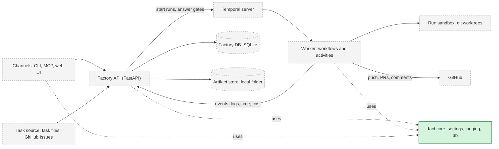
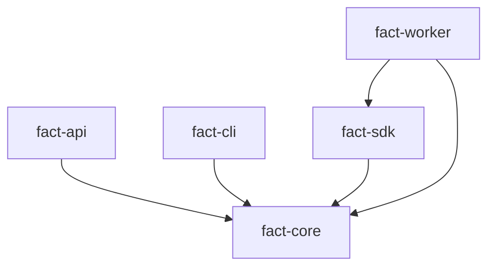

# Architecture

fact is a software factory: a service that turns tracker issues into reviewed GitHub PRs using coding agents, with Temporal running every workflow durably. The design source of truth is `docs/spec/` (start at `docs/spec/README.md`); this file is the index of what exists in code today and how it maps to the design.

**Status (M1 in progress).** `fact.core` has real code: settings (`@core/src/fact/core/settings.py`), structured logging (`@core/src/fact/core/logging.py`) and the async SQLAlchemy layer with Alembic migrations (`@core/src/fact/core/db.py`, `migrate.py`, `@core/migrations/`; schema in `models.py`). `fact.api` has a skeleton (M0-08, see below). `fact.worker` has a skeleton (M0-09): `python -m fact.worker` runs a worker on the `control` task queue with a ping workflow and activity (`client.py`, `ping.py`, `__main__.py`). `fact.cli` (M0-10) has the `fact` command: `fact dev` starts Temporal, the API and the worker; `fact projects list` reads the API; `fact github check` verifies GitHub App access. `fact.core.github` (M1-10) mints per-repository GitHub App installation tokens; the worker's `open_change_set` (M1-11) uses them to push the run's branch and open its PR. `fact.sdk` (M1-12) has the workflow base class `FactWorkflow` and the stage manifest; `.fact/workflows/standard.py` is the first project workflow (`Standard`). Since M1-13, `python -m fact.worker` loads each registered project's workflows from a pinned checkout of its home repository and runs them on a versioned `wf-<project>` worker (pinned runs). Since M1-14, `POST /api/v1/runs/start` starts a project's workflow for a task, and `fact run`, `fact runs` and `fact status` start and follow runs through the API. Since M1-15, `fact use <ref>` pins a checkout of the factory and `fact dev --pinned` runs the API and worker from it, so fact can work on itself (spec `14-dogfooding-and-safety.md`). Since M1-19, `Standard` waits for CI on its PR (`wait_for_ci`) and sends failures to `fix_ci` sessions. Since M2-01, a workflow can wait for a person: `FactWorkflow.gate` opens a gate answered through the `answer_gate` update, `status` is a query and `steer` a signal; `Standard` opens a `needs_human` gate when its checks or CI loop is exhausted. Since M2-02, the API and `fact gate`, `fact steer` and `fact status` answer gates, steer runs and show the open gate. Since M2-03, workflows create notifications through the `notify` control activity (a gate opening, PRs ready, a run ending badly), stored in the `notifications` table, served by `/api/v1/notifications` and listed by `fact inbox` until the M3 Notifications page. Since M2-04, a run can start with an `approve_plan` gate (`require_plan_approval`); rejecting it ends the run `dropped`. Since M2-05, once CI is green `Standard` notifies `prs_ready` and keeps the run open (stage `wait_for_review`) until its PRs are merged or closed, polled by the `wait_for_pr_closed` control activity, and ends `merged` or `closed`. Since M2-06, `fact drop` (`POST /api/v1/runs/{id}/drop`) cancels a run's workflow; `FactWorkflow` handles the cancellation (`fact.sdk.drop`), writes a handoff note (`write_handoff`), tears the workspace down and ends `dropped`, keeping the branch and PR, and the next `fact run` of the task resumes that branch and PR and gets the note as `$handoff`. Since M2-07, a scheduler starts ready tasks by itself: the worker creates the Temporal Schedule `fact-scheduler` (paused unless `concurrency.scheduler_enabled`), whose `SchedulerTick` workflow starts never-run ready file tasks through `POST /api/v1/runs/start` in dependency order within `concurrency.max_runs` and each project's `max_runs`; `fact scheduler on|off|status` controls it. Everything else below marked *planned* is specified in `docs/spec/` and tracked in `tasks/`, but not implemented.

## System Overview

Target architecture (from `docs/spec/04-architecture.md`). Solid boxes exist in code; dashed boxes are planned.



## Package Dependencies (from each `pyproject.toml`)

All packages share the `fact.*` namespace and are members of one uv workspace (`@pyproject.toml`). Dependencies point inward to `core`.



## Component Map

| Component | Path | State | Responsibility |
| --- | --- | --- | --- |
| fact.core | `@core/src/fact/core/` | Partial: `settings.py`, `logging.py`, `db.py`, `models.py`, `enums.py`, `migrate.py`, `migrations/`, `project_config.py`, `types.py`, `activity_contract.py`, `gates.py`, `scheduler.py`, `step_defaults.py`, `tasks/`, `artifacts.py`, `claude_usage.py`, `github/` | Settings loading (per-step-kind limits in `step_defaults.py`, re-exported by `settings.py`), the scheduler's contract (`scheduler.py`: `SCHEDULE_ID` = `fact-scheduler`, workflow `SchedulerTick`, activities `find_ready_tasks` and `start_scheduled_run`, `ReadyTasks` and the pure `plan_starts`, see below), logging, async DB engine and Alembic, DB models (projects, repositories, runs, steps, events, notifications), status/outcome enums and `NotificationKind` (`gate_waiting`, `prs_ready`, `run_failed`, `run_finished`), the activity contract between `fact.sdk` and the worker (`activity_contract.py`: `CONTROL_QUEUE`/`SANDBOX_QUEUE`, `workflow_queue(project)` giving `wf-<project>`, activity names, activity input models, including `GateOpenedInput`/`GateAnsweredInput`, `NotifyInput`, `WaitForPRClosedInput`, `HandoffInput`/`HandoffStep`, `ReportStatusInput` and `PRState` = `merged`/`closed`), the workflow's person-facing handlers (`gates.py`: handler names `ANSWER_GATE` = `answer_gate` (update), `STATUS` = `status` (query), `STEER` = `steer` (signal), so the API and CLI call them by name without importing `fact.sdk`; `GateDecision` approve/reject, `GateAnswer` (`gate_id`, `decision`, `note` up to 4000 chars), `OpenGate`, `StageOutcome`, `WorkflowStatus`, `STEER_MAX_CHARS` 8000; re-exported from `fact.sdk.types`), shared Temporal-boundary types (`Task`, `StepResult`, `RunInput` with `home_repo`, `limits: RunLimits`, `require_plan_approval` (default false) and `handoff_ref` (default None), `Route`, `RouteOverride`, ..., `limit_text`; frozen Pydantic models carrying `ArtifactRef`s, never raw logs), task sources (`tasks/`: `TaskSource` protocol, `source_for`, `FileTaskSource`), artifact store (`artifacts.py`: `ArtifactStore` protocol, `LocalArtifactStore` with atomic writes via `.tmp/`, `step_key`, `handoff_key` = `runs/<run_id>/handoff.md`), Claude Code usage windows (`claude_usage.py`: `ClaudeUsage`/`UsageWindow` with `blocked(threshold)` and `resume_at(threshold)`, `fetch_claude_usage(token)` for the usage endpoint, `parse_rate_limit_info` for stream-json `rate_limit_event`s; the token is passed in, `read_cli_token()` is local-dev only), GitHub App access (`github/`, see below) |
| fact.api | `@api/src/fact/api/` | Partial: `app.py`, `projects.py`, `middleware.py`, `deps.py`, `schemas.py`, `run_schemas.py`, `run_totals.py`, `run_start.py`, `task_ref.py`, `scheduler.py`, `temporal.py`, `routers/`, `__main__.py` | FastAPI app with `/health`, `/api/v1/projects`, the runs, steps and events API, starting runs in Temporal (`POST /api/v1/runs/start`), answering gates, steering, live status and dropping runs (`routers/human.py`), notifications (`routers/notifications.py`), and the scheduler's ready tasks and Schedule state (`routers/scheduler.py`); later logs and costs |
| fact.worker | `@worker/src/fact/worker/` | Partial | Temporal workers on the `control` and `sandbox` queues, plus one workflow worker per registered project on `wf-<project>` (M1-13): `loader.py` (`load_project`: syncs the home mirror, resolves the default-branch SHA, detached worktree at `pinned_dir/projects/<project>/<sha>`, imports `.fact/workflows/*.py` under unique module names `fact_workflows_<project>_<sha12>_<stem>` via a meta path finder; `sandbox_runner()` passes `fact`, `pydantic`, `pydantic_core`, `rich` through the sandbox; a project that fails to load is logged as `workflow_load_failed` and skipped) and `deployments.py` (Worker Deployment Versioning: deployment `wf-<project>`, build id `<factory SHA[:12]>+<home SHA>`, default behaviour `PINNED`, made current on start); the sandbox worker is capped at `concurrency.sandboxes` concurrent activities. Connect (Pydantic data converter), `PingWorkflow` and `ping` activity; `reporting.py` has `StepReporter`, the context manager activities use to report a step (creates the step, binds logs, uploads `output.log`, patches outcome and usage; API failures never fail the step); `runners/` has the `Runner` protocol (`base.py`: `prepare`, `exec`, `teardown`, `capabilities`; `ExecLine`/`ExecExit` stream items), `LocalWorktreeRunner` (`local_worktree.py`: `prepare` refuses a workspace inside `pinned_dir` or inside the running factory checkout (`factory_root`, default `REPO_ROOT`); bare mirror per repo at `repos_dir/<owner>/<repo>`, synced by the public `sync_mirror`, which also follows default-branch renames with `git remote set-head origin --auto`, one worktree per repo at `workspaces_dir/<run_id>/<repo name>`, `WORKSPACE.md`, commit author `fact[bot]` via `GitHubApp.bot_identity()` when the App is configured, else `commit_author_name`/`commit_author_email`; `core.bare` kept in the mirror's `config.worktree`) and `process.py` (spawn with the inherited environment, merged output, process-tree kill on timeout); `activities/workspace.py` (`prepare_workspace` and `teardown_workspace`, control queue), `runners/branches.py` (`free_branch`: the task branch, or `<branch>-<n>` when another worktree holds it or, for a suffix, the remote has it), `activities/shell.py` (`shell_step`, runs `.fact/repo.yaml` lint/test commands from the worktree, heartbeats every 30 s, `passed`/`failed_checks`, on the new `sandbox` queue) and `activities/agent.py` (`agent_step`, sandbox queue, M1-09: routes harness and model, renders `.fact/prompts/<name>.md` from the home repo worktree (`$handoff` from `handoff_ref`, read through the API, since M2-06), runs the harness at the workspace root, uploads the transcript, passes `step_defaults.agent.permission_mode` (default `auto`) and the prompt's output schema (`prompts.BASE_OUTPUT_SCHEMA` plus `.fact/prompts/<name>.schema.json`), and `judge`s the structured answer: `passed` for `status: done`, `needs_human` for `blocked`, `failed_error` without an answer, `stopped_by_monitor` at the turn limit; denied tool calls are logged and kept in `outputs.permission_denials`), `activities/change_set.py` (`open_change_set`, control queue, stage `open_pr`, M1-11: one repository in v0, pushes the run's branch with `git_push.py` and opens or reuses its PR with `pull_requests.py`, body from `pr_body.py` and `templates/pr_body.md`; returns `PRRef`s), `activities/cost_comment.py` (`post_cost_comment`, control queue, M1-16: reads the run and its steps from the API, renders the cost table with `cost_comment.py` and creates or updates the PR comment marked `<!-- fact:cost -->`; not reported as a step), `activities/ci.py` (`wait_for_ci`, control queue, stage `wait_for_ci`, step kind `github`, M1-19: polls the PR head SHA's check runs and commit statuses through `ci_checks.py` every 30 s until all are complete on two polls in a row, 60 min timeout, passes when no check appears within 5 min; `passed`/`failed_checks`; failed GitHub Actions job logs stored as step artifacts `job-<id>.log`, their last 4 KB in `outputs.failures[].log_tail`), `activities/gates.py` (`GateActivities`, control queue, M2-01: `record_gate_opened` creates the gate's step (kind `gate`, idempotent on a 409) as `waiting` and moves the run to `waiting`, returning the step id; `record_gate_answered` finishes the step with the outcome, decision, note and `wait_seconds` (its whole wall time, so it counts as human wait, not machine time) and moves the run back to `running`; 4xx non-retryable), `activities/notify.py` (`NotifyActivities`, control queue, M2-03: `notify` POSTs a `NotifyInput` to `/api/v1/notifications` and returns the notification id; idempotent through the API's `dedupe_key`, so retries are safe; 4xx non-retryable; not reported as a step), `activities/pr_state.py` (`PRStateActivities`, control queue, M2-05: `wait_for_pr_closed` polls `GET /repos/{repo}/pulls/{number}` for each still-open PR every 60 s, heartbeating, and returns `merged` or `closed` per PR; a transient GitHub error skips a poll, 401/404/422 or a missing GitHub App fail it non-retryably; not reported as a step, the workflow records the wait), `activities/handoff.py` (`HandoffActivities`, control queue, M2-06: `write_handoff` renders a dropped run's note with `handoff.py` `render_handoff` and stores it through `PUT /api/v1/artifacts/<handoff_key>`; not reported as a step), `scheduler.py` and `activities/scheduler.py` (M2-07: the `SchedulerTick` workflow on the control queue, `ensure_schedule` run at worker start, and `SchedulerActivities` calling `GET /api/v1/scheduler/ready` and `POST /api/v1/runs/start`; see "The scheduler" below), `activities/control.py` (`ControlActivities`, control queue, M1-12: `mark_task_done` deletes the task file and commits that on the run's branch, `record_run_started`/`record_run_finished` PATCH the run, `record_run_started` also `worker_version` and `home_sha`; not reported as steps), `activities/task_status.py` (`report_status`, control queue, M2-08: applies a `TaskEvent` to the project's `TaskSource` through `events.report`; no workflow calls it until M2-11); worker modules re-export the contract names from `fact.core.activity_contract`; `routing.py` (`choose`: per-field harness/model from override, then `routing.rules`, then `routing.default`); `prompts.py` (`string.Template` prompt rendering, `PromptError`); `python -m fact.worker` runs both activity queues and the project workflow workers, reaches the API at `settings.api_url`, and on Windows treats Ctrl-Break (SIGBREAK) like Ctrl-C so workers drain; it builds one `GitHubApp` per process when configured. Details in `@worker/README.md` |
| fact.worker harnesses | `@worker/src/fact/worker/harnesses/` | Partial: `base.py`, `claude_code.py`, `__main__.py` | Harness contract (`HarnessRequest` with `permission_mode` and `output_schema`, `HarnessResult` with `Usage`, `structured_output` and `permission_denials`, `Harness` protocol `run(request, transcript_path, on_message)`, `HarnessError`) and `ClaudeCodeHarness` (M1-08): runs `claude -p --output-format stream-json --verbose --permission-prompts none` (plus `--permission-mode`, `--json-schema` when set) with the prompt on stdin, writes every output line to the transcript, and reads the result from the final `result` message; spawned through `runners/process.py` (`spawn` options `pipe_stdin`, `merge_stderr`, `limit`). Called by `agent_step`; `python -m fact.worker` registers `ClaudeCodeHarness`. Details in `@worker/README.md` |
| fact.sdk | `@sdk/src/fact/sdk/` | Partial: `types.py` (re-exports `fact.core.types`, enums, `Check`, `CheckResult`), `workflow.py`, `stages.py`, `sessions.py`, `failures.py` (`failure_context`, `ci_failure_context`, `CONTEXT_MAX_BYTES`; `failure_context` re-exported from `workflow.py`), `pull_requests.py` (`PullRequestSteps`, the PR and CI helpers mixed into `FactWorkflow`), `human.py` (`HumanSteps`, the gate, status, steering and notification mixin of `FactWorkflow`), `drop.py` (`DropSteps`, the drop mixin of `FactWorkflow`), `policies.py` (`HEARTBEAT_TIMEOUT`, `NO_RETRY`, `INFRA_RETRY`, `LONG_WAIT_RETRY`), `review.py`, `change_set.py` | Workflow base class `FactWorkflow`, `Stage` and `@stages` for project workflows; calls activities by name, never imports `fact.worker`; see below |
| fact.cli | `@cli/src/fact/cli/` | Partial: `main.py`, `dev.py`, `use.py`, `projects.py`, `github.py`, `runs.py`, `inbox.py`, `scheduler.py`, `supervisor.py` | The `fact` Typer command (script entry `fact.cli.main:app`): `--version`, `fact dev [--pinned]`, `fact use`, `fact projects list`, `fact github check`, `fact github labels sync`, `fact run`, `fact runs`, `fact status`, `fact gate`, `fact steer`, `fact drop`, `fact inbox`, `fact scheduler`; see below |
| web | `web/` | Absent | React UI, from M3 |
| `.fact/` | `.fact/` | Partial: `project.yaml`, `repo.yaml`, `workflows/` (`standard.py`, `README.md`), `prompts/` (`implement.md`, `fix_checks.md`, `review.md` + `review.schema.json`, `address_review.md`, `learn.md` + `learn.schema.json`, `fix_ci.md`, `README.md`) | fact's own project config, workflows and prompts; prompts are rendered by `agent_step` |
| fact.yaml | `@fact.yaml` | Exists | Global settings and project registry (one project: `fact`, home `Kahncode/fact`) |
| scripts | `scripts/` | Exists | Python helper scripts: `task_loop.py` runs `/next-task` in a loop and waits out usage windows with `fact.core.claude_usage`; `claude_run.py` invokes `claude -p` and logs each run as raw events (`.jsonl`) and a readable transcript (`.log`, formatted by `claude_log.py`) in `.tmp/task-loop/logs/`; `loop_report.py` prints why the loop stopped and what a person must do (tasks a run reported `BLOCKED:`, which are skipped rather than retried, and open `human_actions`); `loop_recovery.py` persists the task in progress (`.tmp/task-loop/state.json`), resumes it after a restart and reopens a task whose run hit the usage limit (see `docs/decisions.md`); `task_files.py` parses and orders tasks; tests in `scripts/tests/`. Every script is Python |
| Agent tooling | `.agents/` | Exists | Canonical skills (`.agents/skills/`) and subagent definitions (`.agents/agents/`); the SessionStart hook `@.claude/hooks/project_dot_agents.py` projects them into the gitignored `.claude/skills` and `.claude/agents` (see `docs/decisions.md`) |
| CI | `@.github/workflows/ci.yaml` | Exists | On push to main and PRs: `uv sync --locked`, ruff, black `--check`, pytest on ubuntu and windows |
| Work items | `tasks/` | Exists | One markdown file per task, grouped by milestone `M0`..`M2` so far, plus `backlog.md` |
| Design spec | `docs/spec/` | Exists | Design, one file per section |

## What exists in `fact.core`

**Settings** (`get_settings()`, frozen pydantic-settings `Settings`):

- Source priority, low to high: field defaults, `fact.yaml`, `fact.<env>.yaml`, `.env`, `FACT_*` env vars with `__` nesting.
- `FACT_CONFIG` relocates `fact.yaml`; `.env` is read from the same folder. `FACT_ENV` (`local`, `test`, `dev`, `prod`) selects the overlay file.
- `${VAR}` in YAML expands from the environment, else from the contents of a file at that path (mounted secret); unresolved references are left as written.
- Top-level keys: `env`, `log_level` (optional; `FACT_LOG_LEVEL`; one of DEBUG, INFO, WARNING, ERROR, CRITICAL, case-insensitive), `log_gcp` (bool), `data_dir`, `commit_author_name`, `commit_author_email`, `github_app_id` (str: App ID or Client ID; `FACT_GITHUB_APP_ID`), `github_app_private_key_path` (`FACT_GITHUB_APP_PRIVATE_KEY_PATH`), `github_api_url` (default `https://api.github.com`). `effective_log_level`: `log_level`, else DEBUG for `local`/`dev` and INFO for `test`/`prod`. `is_dev_environment()` is true for `local`, `test`, `dev`.
- Sections: `temporal` (address, namespace, `ui_url` for run links, default `http://localhost:8233`), `api` (host, port), `concurrency` (sandboxes, planners, `max_runs` default 2, `scheduler_enabled` default false, `scheduler_interval_seconds` default 30), `projects` (name, home, optional local path, `max_runs` default 1), `routing` (`default` `Route`, default `claude-code`/`sonnet`; `rules` keyed `<complexity|*>.<stage|*>`, each a `RouteOverride`), `step_defaults` (typed per kind: `agent` 60 min, `max_turns` 100 and `permission_mode` `auto`, `shell` 15 min; other kinds get `StepDefaults()`; read with `Settings.step_default(kind)`; `timeout_minutes` is not applied yet). Derived paths under `data_dir` (default `~/.fact`): `fact.db`, `temporal.db`, `artifacts/`, `workspaces/`, `repos/`, `pinned/`.
- `api_url` is the base URL clients (worker, CLI) use to reach the API: `http://<api.host>:<api.port>`, with wildcard bind hosts `0.0.0.0` and `::` mapped to `127.0.0.1` and `::1`, and IPv6 literals bracketed.
- `project_path(ref)` gives a project's local checkout (`projects[].path`; a relative path resolves against the folder of `fact.yaml`), or None without one. The API and the worker's `report_status` use it.
- `override_settings_class()` lets an app load a `Settings` subclass once, before first use; `reset_settings()` is for tests.

**Logging** (structlog over stdlib logging):

- `configure_logging(env, level, *, gcp=False, extra_processors=())` once at process start (the API calls it in `create_app`); console renderer for `local`/`test` (colored when stdout is a TTY), JSON otherwise, to stdout. Safe to call again; the last call wins.
- JSON lines add the call site (file, function, line), decode bytes, and honor level filtering (`filter_by_level`). With `gcp=True`, `format_gcloud_logs` (`@core/src/fact/core/logging_gcp.py`) renames `event`/`level` to `message`/`severity` and folds `http_request`/`http_response` into `httpRequest` (method, url, status, latency, user agent, request size); bodies, query and headers stay as top-level `request_body`, `response_body`, `request_query` and `request_headers`.
- stdlib records (uvicorn, temporalio) pass through the same processors.
- `bind_run(run_id, step_id)` context manager binds ids to every line in scope.

**Database** (`db.py`, `migrate.py`, `core/migrations/`; see `@core/README.md`):

- `Base` with a constraint naming convention, `database_url(settings)`, `create_engine(url)` (pragmas `foreign_keys=ON`, `journal_mode=WAL`), `session_factory(engine)`.
- `models.py`: `Project`, `Repository`, `Run`, `Step`, `Event`, `Notification` (typed `Mapped[...]`, portable types only; enums in `enums.py` stored as strings). Run and step ids are uuid4 hex strings, the others integers. The initial Alembic revision creates the first five; a second revision (`..._notifications.py`) adds `notifications` (`run_id` nullable FK to `runs`, indexed; `kind`, `title` up to 300 chars, `body`, `link`, `created_at`, `read_at`, `dedupe_key` unique, up to 300 chars).
- Alembic with an async `env.py` (URL from settings, `render_as_batch=True`); `migrate.upgrade(url)` runs `upgrade head` in code and creates a missing data dir.

**Project config** (`project_config.py`; fact's own files are in `@.fact/`):

- `load_project_config(home_path)` reads `<home>/.fact/project.yaml` into `ProjectConfig` (name, repositories, task source, runner pool, budget, merge policy, plan approval, workflows map with `default`); `load_repo_config(repo_path)` reads `.fact/repo.yaml` into `RepoConfig` (`setup`, `lint`, `test`, `build`, each a list of argv lists).
- Models are frozen and reject unknown keys; failures raise `ConfigError` naming the file and field.

**Task source interface** (`@core/src/fact/core/tasks/base.py`, `events.py`; tests in `@core/tests/test_task_source.py`): `TaskSource` protocol (async `list_ready`, `get`, `deps_done`, `comment`, `set_labels`, `write_context`, `link_prs`, `close`; sync `mark_done`), `parse_key`, `branch_name`, `dependency_key`, and `source_for(project_config, settings, root)` (None for `github` until M2-09). The API (`fact run`, the scheduler), `mark_task_done` and `report_status` go only through it. `events.report` maps a `TaskEvent` (`run_started`, `gate_opened`, `gate_answered`, `prs_opened`, `merged`, `closed`, `dropped`) to write-backs.

**Task files** (`@core/src/fact/core/tasks/files.py`; tests in `@core/tests/test_task_files.py`):

- `FileTaskSource(root, folder="tasks")` reads `tasks/<milestone>/<NN>-<slug>.md` into `Task` models. Implements `TaskSource` (write-backs only log). Sync methods: `all()`, `find(key)`, `status(key)`, `all_deps_done(task)`, `ready()`, `validate() -> list[str]`, `mark_done(worktree, key)`, `depths()` (dependency depth per task key, for the scheduler's order). Only `fact.core.tasks` constructs it (through `source_for`); other code imports it only in tests. The task branch name comes from the module-level `fact.core.tasks.branch_name(key)`.
- The optional front matter field `require_plan_approval` becomes `Task.require_plan_approval` (`None` when absent: the project decides).
- Statuses are not on the `Task` model; read them with `status(key)`. `mark_done` deletes the task's file: a finished file task is removed, not marked (remote sources such as GitHub Issues will mark theirs done).
- A dependency whose file is missing counts as done if its number is below the highest remaining task in its milestone, or its milestone is below the highest milestone present. `validate()` therefore accepts such ids and cannot catch typos below that bound; an id above it (M1-99 when M1-19 is highest) is an error.
- `validate()` on the real `tasks/` folder runs as a test in CI.

**GitHub App** (`@core/src/fact/core/github/`: `app.py`, `client.py`, `labels.py`; details in `@core/README.md`; dependencies `pyjwt[crypto]`, `httpx`):

- `GitHubApp(app_id, private_key, *, api_url, transport, clock)`; `from_settings()` raises `GitHubAppConfigError` if unset and resolves a relative key path from the folder of `fact.yaml`. `app_jwt()` signs RS256 (iat now-60 s, exp now+9 min). `installation_token(owner/repo)` mints a token scoped to that one repository, cached per repository until 5 minutes before expiry, minted once under concurrency. `bot_identity()` gives `<slug>[bot]` and its noreply email. Caches are per instance: one `GitHubApp` per process.
- `github_client(token, *, api_url)` (or `GitHubApp.api_client(token)` on the App's API URL): `httpx.AsyncClient` with bearer auth and GitHub API headers; errors raise `GitHubAuthError` (401), `GitHubForbiddenError` (403), `GitHubNotFoundError` (404) or `GitHubError`, never carrying headers. Tokens never appear in logs or `repr()`.
- `labels.py`: `FACT_LABELS` (the `fact:*`, `type:*` and `complexity:*` labels from `docs/spec/12-integrations.md`, each a `Label(name, color, description)`) and `sync_labels(client, owner/repo)`, which creates missing labels and fixes colour, description and case of existing ones (names match case-insensitively), never deletes, and returns a `LabelChange` (created, updated, unchanged) per label. `split_full_name(owner/repo)` (in `app.py`) validates and splits a repository name.
- Used by the worker: `LocalWorktreeRunner` commits as `bot_identity()`, and `open_change_set` pushes and opens PRs with installation tokens (see `@worker/README.md`).

## What exists in `fact.api`

- `create_app(settings=None)` (`@api/src/fact/api/app.py`) builds the FastAPI app. Its lifespan configures logging, runs `migrate.upgrade` in a thread (it starts its own event loop), creates the engine and session factory on `app.state` (`settings`, `engine`, `sessions`), calls `sync_projects`, and disposes the engine on shutdown.
- `sync_projects` (`@api/src/fact/api/projects.py`) upserts each `fact.yaml` project and the repositories from its `.fact/project.yaml` into the DB. It is idempotent and never deletes rows. An invalid or missing `project.yaml` raises `ConfigError` and the API fails to start. A relative project `path` in `fact.yaml` resolves against the folder of `fact.yaml`; a project without `path` gets no repositories.
- Routes: `GET /health` and `GET /api/v1/projects` (`routers/health.py`, `routers/projects.py`; response models in `schemas.py`, dependencies in `deps.py`).
- Runs API (`routers/runs.py`; models in `run_schemas.py`), all under `/api/v1`:
  - `POST /runs` (by project name), `PATCH /runs/{id}`, `GET /runs` (filters `project`, `status`, `task_key`, `workflow_id`; newest first), `GET /runs/{id}` (run plus steps ordered by queued, started, stage, attempt).
  - `POST /runs/{id}/steps`, `PATCH /steps/{id}`, `POST /runs/{id}/events` (batch; a `step_id` must belong to the run).
  - 404 for an unknown run, step or project; 409 for a duplicate `workflow_id` or duplicate step (run, stage, attempt). A new step is `running` if `started_at` is set, else `queued`.
  - In PATCH bodies an explicit `null` is ignored for NOT NULL columns; only nullable ones (outcome, timestamps, refs, step outputs) can be cleared.
  - `recompute_totals` (`run_totals.py`) runs on every step PATCH and recomputes the run's `machine_seconds` (step wall time minus `wait_seconds`), `human_wait_seconds`, tokens and `cost_usd` from finished steps only.
- Starting a run (`routers/run_start.py`, `run_start.py`, `task_ref.py`, `temporal.py`): `POST /api/v1/runs/start` with `task_key`, optional `project` and `override_deps`.
  - Finds the project: the one given, else every project with a local `path` whose task source is `files` (a broken project is skipped with a warning while searching; several matches is 409).
  - Runs `git fetch origin <default branch>` (`GIT_TERMINAL_PROMPT=0`; on failure the last fetched state is used) and reads the task folder from `origin/<default branch>` with `git archive` into a temp dir, read through `source_for` (`project_tasks` in `@api/src/fact/api/task_ref.py`). Unfinished dependencies give 409 with `detail.missing_deps` unless `override_deps`.
  - Workflow type is `workflows.<task type>` from `project.yaml`, else `workflows.default`. Workflow id is `run-<task key, unsafe characters as '-'>-<n>` (e.g. `run-task-M1-02-1`), `n` one past the highest used for that task.
  - Inserts the run as `queued`, then starts the workflow on `wf-<project>` with a `RunInput` (repos by `merge_order`, branch `fact/task-<id, lowercased>` from `branch_name`, task complexity, `limits` from `step_defaults`, `run_url` = the Temporal UI link, shown in the PR body, `require_plan_approval` from the task's front matter when set, else `ProjectConfig.require_plan_approval`, default true; fact's own `.fact/project.yaml` sets it false). A failed start keeps the row as `finished`/`failed`; `WorkflowAlreadyStartedError` moves to the next `n` (see `docs/decisions.md`).
  - `RunInput.handoff_ref` (M2-06) comes from `latest_handoff(session, store, project_id, task_key)`: it walks the task's finished runs newest first, skipping runs that never started (failed starts); the first run not `dropped` ends the search (the note is stale); the newest dropped run whose note exists in the artifact store gives its `handoff_key` (a dropped run without a note, such as a rejected plan, is passed over).
  - `only_if_never_run` (M2-07, default false; the scheduler always sends it) answers 409 when the task already has a run, ended or not; a start that never reached Temporal (`counts_as_run()` in `run_start.py`) does not count.
  - Returns `run_id`, `workflow_id`, `workflow_type`, `project`, `temporal_url` (`<temporal.ui_url>/namespaces/<ns>/workflows/<id>`).
  - The Temporal client (`app.state.temporal`, a `TemporalConnection`) connects on first use, so the API starts while Temporal is down; an unreachable Temporal is 503, a refused start 502. Refusals (unknown task, missing deps) need no Temporal.
- People in the loop (`routers/human.py`, M2-02), under `/api/v1`, calling the workflow's handlers by name from `fact.core.gates` (never importing `fact.sdk`):
  - `POST /runs/{id}/gates/{gate_id}` (`decision` approve/reject, `note`) runs the `answer_gate` update; `POST /runs/{id}/instructions` (`text`, not blank) sends the `steer` signal. Both return `run_id` and `human_touches`; each success increments `Run.human_touches` with one SQL `UPDATE` (refusals do not count).
  - `GET /runs/{id}/status` runs the `status` query and returns `WorkflowStatus` (stage, attempt, open gate, outcomes).
  - `POST /runs/{id}/drop` (M2-06, body `reason`, optional, up to 4000 chars) cancels the workflow with `handle.cancel(reason=...)` and answers 202 with `run_id` and `human_touches` (one touch). Accepted, not done: the run's own worker version processes the cancellation. 409 when the run row is already `finished`.
  - Errors: 404 unknown run; 409 with the validator's message when the gate is not open; 409 when the workflow is not running in Temporal (`NOT_FOUND`); 503 when no worker answers within `WORKER_TIMEOUT` (8 s, below the CLI's 10 s HTTP timeout); 502 for other Temporal failures or a failed query.
- Notifications (`routers/notifications.py`, M2-03), under `/api/v1`:
  - `POST /notifications` (`run_id` optional, `kind` a `NotificationKind`, `title` 1-300 chars, `body`, `link`, `dedupe_key` 1-300 chars) is idempotent on `dedupe_key`: 201 with the new notification, or 200 with the existing one unchanged (also when a concurrent insert wins the unique constraint). 404 for an unknown `run_id`.
  - `GET /notifications?unread=true&limit=` returns the newest first (by `created_at`, then id); `limit` defaults to 100, max 500.
  - `POST /notifications/{id}/read` sets `read_at` once; reading again keeps the first time. 404 for an unknown id.
- Scheduler (`routers/scheduler.py`, `scheduler.py`, M2-07), under `/api/v1`: `GET /scheduler/ready` returns `ReadyTasks` (see "The scheduler" below); `GET /scheduler` describes the `fact-scheduler` Schedule (`paused`, `note`, `interval_seconds`, the next and recent ticks); `POST /scheduler/on` and `/scheduler/off` unpause and pause it and return the same state. 404 when the Schedule does not exist (the worker creates it), 502 when Temporal refuses.
- `RequestIdMiddleware` (`middleware.py`, pure ASGI) sets or propagates the `X-Request-ID` header (a supplied value must match `[A-Za-z0-9._-]{1,128}`, else a new UUID in dashed form), binds `request_id` in structlog and logs one `request_completed` line per request: method, path, query, headers without credentials, status, latency, and JSON request and response bodies up to 8 KiB with secret-looking keys masked (`body_capture.py`); `/health` is skipped. Header values, query parameters and JSON keys that look secret are replaced by `***` (`is_secret_key` in `body_capture.py`: a name word of password, secret, token, authorization, credential, signature or cookie, or containing `api_key` or `private_key`; `input_tokens` is not masked). A request cancelled before a response is logged as 499. `unhandled_exception_handler` returns a JSON 500 with `request_id` (plus `detail` only in local and test) and logs it with the id passed explicitly, because it runs outside the middleware.
- Logging is configured in `create_app` (before the app is built) from `settings.env`, `settings.effective_log_level` (`FACT_LOG_LEVEL`; default DEBUG in local and dev, INFO elsewhere) and `settings.log_gcp` (Cloud Logging fields: `message`, `severity`, `httpRequest`; `core/src/fact/core/logging_gcp.py`). `python -m fact.api` runs uvicorn with `log_config=None` and `access_log=False` so its lines go through structlog. JSON lines carry the call site.
- `@api/tests/test_routes.py` fails when a route is missing from `TESTED_ROUTES` or lists a test that does not exist; add every new route there.
- Run with `uv run python -m fact.api`: uvicorn on `settings.api.host` and `settings.api.port`. Tests: `@api/tests/test_app.py`, `@api/tests/test_runs.py`, `@api/tests/test_run_start.py`, `@api/tests/test_human.py` (time-skipping Temporal with a one-gate workflow), `@api/tests/test_drop.py` (the drop endpoint, the reason reaching `workflow.cancellation_reason()`, `latest_handoff`), `@api/tests/test_notifications.py`, `@api/tests/test_scheduler.py` (ready tasks, a task with a run not offered again, on/off/status against the Temporal dev server); shared fixtures in `@api/tests/conftest.py`, task-repository helpers in `@api/tests/task_repo.py`.

## What exists in `fact.sdk` and `.fact/workflows/`

- `@sdk/src/fact/sdk/workflow.py`: `Stage(id, label, kind, loops_to=None)` and the `@stages([...])` class decorator (rejects duplicate ids and unknown `loops_to`), stored as `stage_manifest`; `manifest()` returns plain dicts for the UI.
- `FactWorkflow` helpers: `execute(run_input, body)` records the run started (with the build id from `workflow.info().get_current_deployment_version()` as `worker_version`) and finished (best effort; `failed` when `body` raises a Temporal failure) and calls `teardown_workspace` (best effort) only when the run ends in `PUSHED_OUTCOMES` (`pr_opened`, `merged`, `closed`, `abandoned`), `prepare()` (once per run; a second call returns the same handle), `setup(stage_id="setup")` (each repository's `.fact/repo.yaml` `setup` commands as shell steps in the sandbox; returns the first step that did not pass, else None), `agent(stage_id, prompt, context, pr_text=True)` (`pr_text=False`: the session's `title`/`summary` are not taken for the PR), `until_green(checks, fix_prompt, max_attempts, stage_id="checks", fix_stage="implement")`, `mark_task_done()`. The PR and CI helpers live in the mixin `PullRequestSteps` (`@sdk/src/fact/sdk/pull_requests.py`): `pr_text()` (agent-written `title`/`summary` outputs, else a conventional title from the task), `open_change_set(title, summary, criteria=())` (`criteria`: `CriterionResult`s from a review, shown as a table in the PR), `push_change_set()` (pushes the same change set again as the next `open_pr` attempt and updates the PR), `post_cost_comment(prs)` (best effort), `wait_for_ci(pr)`, `until_ci_green(prs, fix_prompt, max_attempts, stage_id="wait_for_ci", fix_stage="fix_ci")`, `wait_for_pr_closed(prs, stage_id="wait_for_review")` (M2-05, below). `self.prs` holds the PRs at their latest pushed head SHA. The gate, status and steering handlers live in the mixin `HumanSteps` (`@sdk/src/fact/sdk/human.py`); Dropping lives in the mixin `DropSteps` (`@sdk/src/fact/sdk/drop.py`, below). `FactWorkflow` is `(PullRequestSteps, HumanSteps, DropSteps)`; it and `HumanSteps` call `super().__init__()`, so a subclass defining `__init__` must call `super().__init__()` too.
- Dropping a run (`DropSteps`, M2-06): a drop is a Temporal cancellation of the workflow with a reason; `drop_requested()` is `workflow.cancellation_reason() is not None`. `execute` (which records the run started inside its `try`) catches `FailureError` or `asyncio.CancelledError` and, when a drop was requested, returns `await self.drop()` instead of recording `failed`; the workflow then completes normally, not as Temporal-cancelled. A drop arriving as `body` returns goes through `drop()` too, unless the outcome is in `PUSHED_OUTCOMES`, which records its real outcome. `stop_if_dropped()`, called by `next_attempt` and `_control`, raises `CancelledError`, so no step starts after a drop even when workflow code swallowed a cancelled activity's error. Agent and shell steps use `ActivityCancellationType.WAIT_CANCELLATION_COMPLETED`, so the drop waits until the session or subprocess has stopped (the cancellation reaches the activity at its next heartbeat). `drop()` writes the handoff note with `write_handoff` (`HandoffInput`: `run_id`, `task`, `reason`, the last stage and attempt from `next_attempt`, every agent step as `HandoffStep(stage_id, attempt, outcome, summary)`, `prs`), tears the workspace down, then records `dropped` last, so a run shown `dropped` already has its note and a free branch; each of the three is best effort. It returns `RunResult(outcome=DROPPED, prs, summary="dropped: <reason>" or "dropped")`. The remote branch and PRs are kept; a restart reuses them through existing mechanics (`LocalWorktreeRunner` gets the unsuffixed task branch, now free, and resumes from `origin/<branch>`; `open_or_update_pr` finds the branch's open PR). Every agent session gets `RunInput.handoff_ref` as `AgentStepInput.handoff_ref`.
- Gates and steering (`HumanSteps`, names from `fact.core.gates`): `await self.gate(gate_id, kind, details)` opens a gate (unique id per run; its step is stage `kind`, numbered by `next_attempt`), records it with `record_gate_opened`, waits with `workflow.wait_condition` (no timer, no activity: free while open, survives worker restarts), records the answer with `record_gate_answered` and returns the `GateAnswer`. Gate recording is best effort (a failure logs a warning). The `answer_gate` update's validator refuses an unknown gate (`unknown gate 'x'; open gates: ...`) or a closed one (`gate 'x' is already closed: answered approve`), so the caller gets a `WorkflowUpdateFailedError`, never a silent no-op. The `status` query returns the latest stage and attempt (set by `next_attempt`), the open gate and the outcome of every step that ended (agent, shell, `wait_for_ci`, `open_pr`, gate). The `steer(text)` signal queues stripped text; the next agent session gets it appended to its context under `## Additional instructions` (`with_steering`; the newest 8000 chars), then the queue is cleared. A running session is never interrupted.
- Notifications (`HumanSteps`, M2-03): `await self.notify(kind, title, body="", link=None, key="")` runs the `notify` control activity with dedupe key `<run_id>:<key or kind>` (cut to 300 chars; title cut to 300) and link defaulting to `RunInput.run_url`; it is best effort (a failed activity logs a warning). `gate()` notifies `gate_waiting` once per gate (key `gate:<gate_id>`, body the details' `summary` plus the `fact gate <run_id> approve|reject` hint) right after recording it. `notify_prs_ready(prs, body="")` sends `prs_ready` (link: the first PR). `notify_run_end(result)` sends `prs_ready` through it for `pr_opened`, `run_failed` for `failed` or `needs_human`, else `run_finished` (`merged`, `closed`, `dropped`); the key is the kind, so one of each per run. `FactWorkflow.execute` does not call it; the workflow does. `NotificationKind` is re-exported from `fact.sdk.types`.
- `until_ci_green`: waits for CI on every PR; on failure a fresh `fix_stage` session gets `ci_failure_context` (each failed job's name, conclusion, link and log tail), then `push_change_set` and wait again. `max_attempts` caps the fix sessions. Returns `passed`, or `needs_human` when the fixes are exhausted, a fix session does not pass, a fix commits nothing (head SHAs unchanged), or CI timed out (no fix is tried then).
- `wait_for_pr_closed` (M2-05): with no PR returns `pr_opened` at once. Otherwise records a gate-like step (stage and kind `wait_for_review`, step kind `gate`, id `wait_for_review-<attempt>`, details `summary` and `prs`) through `record_gate_opened`/`record_gate_answered`, so the run shows `waiting` and the whole wait is `wait_seconds` (human wait). The gate is never in `_open_gates`: `answer_gate` and `fact gate` cannot answer it, and the `status` query shows the stage with no gate. It runs the `wait_for_pr_closed` activity with start-to-close and schedule-to-close `REVIEW_TIMEOUT` (30 days), heartbeat 2 min and `LONG_WAIT_RETRY` (unlimited attempts, bounded by schedule-to-close). All merged: step `passed` (approve), run outcome `merged`; else step `needs_human` (reject), `closed`; the note lists each PR's state. If the activity fails, the step ends `needs_human` with the error as note and the error is re-raised (the run fails, workspace kept).
- `until_green`: `max_attempts` caps fix sessions, so checks run at most `max_attempts + 1` times; it stops early when a fix session does not pass. Fix sessions are new attempts of `fix_stage`. Attempt numbers are per stage; each shell step in `checks` takes the next one.
- Retries: agent steps are never retried by Temporal (`NO_RETRY`); `FactWorkflow.agent` resumes a session at most once (`fact.sdk.sessions`): when the worker stopped during it (`AGENT_INTERRUPTED`, or a heartbeat timeout whose last heartbeat carries the session id), or when the agent answered `blocked` with `retryable: true`, after a 2 min durable timer. The resume is a new attempt of the stage with `resume_session_id`. No answer, the turn limit or a timeout is never retried; shell and control steps, including `wait_for_ci`, use `INFRA_RETRY` (5 attempts); `wait_for_pr_closed` uses `LONG_WAIT_RETRY`. The policies and `HEARTBEAT_TIMEOUT` (2 min) are in `@sdk/src/fact/sdk/policies.py`. Timeouts come from `RunInput.limits`, filled by whoever starts the run; workflow code reads no settings.
- `@.fact/workflows/standard.py`: `Standard` (Temporal type `standard`), stages `approve_plan` (kind `gate`), `prepare`, `setup`, `implement`, `checks` (loops to `implement`), `review`, `address_review` (loops to `checks`), `learn`, `open_pr`, `wait_for_ci` (loops to `fix_ci`), `fix_ci` (loops to `open_pr`), `wait_for_review` (kind `gate`, label "Wait for review"), `needs_human` (kind `gate`). When `RunInput.require_plan_approval` is on, `Standard` first opens gate `approve_plan` (id, kind and stage), before any workspace exists, with details `summary`, `title`, `path` and `acceptance_criteria`: approve goes on; reject ends the run `dropped` with summary `plan rejected: <note>` (the gate step itself ends `needs_human` with the note, as every rejected gate does), with no workspace to tear down, and `notify_run_end` sends `run_finished`. After green checks, one `review` session (routed to opus by `*.review`) answers each acceptance criterion and lists findings; `fact.sdk.review.parse_review` validates them (an invalid answer is `failed_error`). An unmet criterion or a medium/high finding runs `address_review` with `review_context(review)`, then the check loop again (one round in v0). Outcomes: an implement, review or address-review step ending `needs_human` is `needs_human`, any other failure `failed`. When `until_green` (checks, 3 fix sessions) or `until_ci_green` gives up, `Standard` opens a `needs_human` gate with id `<loop>-<n>` (`checks-1`, `wait_for_ci-2`, ...) and details `{loop, summary}`: approve runs that loop once more (steering reaches its fix sessions), reject ends the run `needs_human` with the note appended to the summary (`; rejected: <note>`), with no PR for checks and the PR open for CI. Once checks are green, a `learn` session updates the context docs on the branch and answers the PR `title` and `summary` (a learn session that does not pass, or gives no text, falls back to the implement session's text and never fails the run; fix and address sessions never write the PR text), the task is marked done, the PR opened with the review's criteria table and the cost commented on it. Then `until_ci_green(prs, "fix_ci", MAX_CI_FIX_ATTEMPTS=2)` (with its gate, above); A rejected CI gate is `needs_human` with the PR open (and the workspace kept; the cost comment is updated once more). Once CI is green (M2-05), the cost comment is updated, `notify_prs_ready` sends `prs_ready`, `wait_for_pr_closed` waits for the PRs to merge or close, the cost comment is updated again (with the review wait), and the run ends `merged` or `closed` with summary the PR URLs; `execute` tears the workspace down. `Standard` no longer ends `pr_opened`. A drop (M2-06) ends it `dropped` through `execute` at any stage. `Standard.run` calls `notify_run_end` with the result, and also when `execute` raises a `FailureError` (as `failed`, with the PRs opened so far) before re-raising.
- Tests: `@worker/tests/test_standard_workflow.py` runs `Standard` in a time-skipping environment against fake activities registered under the real names, and replays the green run's history; review, learn and CI loops are in `test_standard_review.py`, `test_standard_learn.py` and `test_standard_ci.py`; gates (approve with a replay, reject with the status query, unknown and closed gate errors, steering, a several-day wait with no activity or timer) in `test_standard_gates.py`, with `gate_harness.py` (`open_gate` polls the status query, `answer` sends the update). `FakeActivities.gate_decisions` answers gates from inside the fake `record_gate_opened` (see `docs/decisions.md`). `@sdk/tests/test_human.py` and `@worker/tests/test_gate_activities.py` cover the mixin and the gate activities. `@worker/tests/test_standard_notify.py` checks `Standard`'s notifications: PRs ready on a green run, one per gate then the end, a blocked agent and a failed run, and a failing `notify` that does not fail the run. `@worker/tests/test_standard_plan_approval.py` covers the plan gate: skipped when off, answered before `prepare_workspace` on approve, and a reject that ends `dropped` with no workspace or agent step. `@worker/tests/test_standard_merge.py` covers the review wait (ends `merged`/`closed` with teardown, order of `prs_ready`, cost comments and the wait, a failed wait that ends its step and fails the run) and `@worker/tests/test_wait_for_pr_closed.py` the activity against mocked GitHub responses. `@worker/tests/test_standard_drop.py` drops `Standard` at a gate, during the wait for review (PR kept, history replayed) and during an agent session (teardown after the session stopped), and checks a restart passes `handoff_ref` to every agent session; `@worker/tests/test_handoff.py` covers the note and `$handoff`; `test_change_set.py::test_restart_after_a_drop_reuses_the_branch_and_the_pr` checks the restart's branch, start commit and PR with real git and mocked GitHub. Shared run input and scripted answers live in `@worker/tests/standard_inputs.py`; `FakeActivities.pr_state` sets how each PR ends and `FakeActivities.gates(name)` lists gate calls without the review wait.

## What exists in `fact.cli`

- `fact` (`@cli/src/fact/cli/main.py`): Typer app with `--version`, the `dev` and `use` commands and the `projects` and `github` groups. Dependencies: `typer`, `httpx`.
- `fact github check <owner/repo>` (`github.py`): configures logging at WARNING, mints an installation token through `GitHubApp.from_settings()` and prints the app slug and id, installation id and account, and token expiry, never the token. Exits 1 with a readable error on a `GitHubError`, a bad name, a network failure or a 2xx response with an unexpected body (`error: unexpected GitHub response (missing ...)`). `make_app()` is the test seam.
- `fact github labels sync <owner/repo>` (`github.py`): runs `sync_labels` with an installation token for that repository and prints one line per label (`created`, `updated` or `unchanged`) and a summary (`<n> of <total> labels changed on <owner/repo>`); same error handling as `check`.
- `fact projects list` (`projects.py`): `GET /api/v1/projects` at `settings.api_url`, printed as a `NAME`/`HOME`/`REPOSITORIES` table; exits 1 with a message when the API is unreachable or answers an error. `make_client()` is the seam tests replace with an `httpx.MockTransport` client.
- `fact run <task_key> [--force-deps] [--project]`, `fact runs [--project] [--status]` and `fact status <run id | workflow id>` (`runs.py`) call the runs API at `settings.api_url`. `run` prints the workflow id, run id and Temporal UI link, and names missing dependencies on a 409; `runs` prints a table, newest first; `status` resolves a `run-...` id through `GET /runs?workflow_id=`, then prints the run and its steps with durations, outcome, cost and artifact links for logs and transcripts; for a run not finished it adds a `Gate:` line from the status query (the open gate, `none open`, or `unknown (<error>)`).
- `fact gate <run> approve|reject [--note TEXT] [--gate ID]` and `fact steer <run> TEXT` (`runs.py`) call the gate and instructions endpoints. Without `--gate`, `gate` answers the open gate from the status query, or fails with `has no open gate`; API errors print as `error: API answered <code>: <detail>`. `fact drop <run> [--reason TEXT]` (M2-06) calls the drop endpoint and says the run ends `dropped` once its worker has written the handoff note and removed its workspace; then `fact run` restarts the task. `@cli/tests/test_gate.py` (gates, steering, drop) runs the CLI end to end against the real API app and a time-skipping Temporal. `call_api` and `api_error` in `runs.py` are the shared helpers other command modules use.
- `fact scheduler on|off|status` (`scheduler.py`, M2-07): `POST /api/v1/scheduler/on|off` or `GET /api/v1/scheduler`, then prints whether the scheduler is on or off (paused), its interval, note, next tick (when on) and last tick. `@cli/tests/test_scheduler.py`.
- `fact inbox [--all]` (`inbox.py`, M2-03): `GET /api/v1/notifications` (`unread=true` unless `--all`) printed as an `ID`/`KIND`/`TITLE`/`CREATED`/`STATE`/`LINK` table, newest first; `fact inbox read <id>` marks one read. `@cli/tests/test_inbox.py` runs it against the real API app through `@cli/tests/api_bridge.py`, the bridge shared with `test_gate.py`.
- `fact dev` (`dev.py`): fails with an install hint if `temporal` is not on PATH, creates `data_dir`, then starts, in order: `temporal server start-dev --db-filename <data_dir>/temporal.db --port <port of temporal.address> --ui-port 8233`, `python -m fact.api`, and `python -m fact.worker` (started only once Temporal's port accepts connections, 60 s timeout). Exit code is 0 on Ctrl-C, else the first child's exit code. With `--pinned`, Temporal runs as before but the API and worker run from the pinned version as `<checkout>/.venv/Scripts/python -m fact.api|fact.worker` (`bin/python` on POSIX; built by `fact use`), with `FACT_CONFIG` set to the source tree's `fact.yaml` so the pinned checkout reads the same config and `.env`; it exits 1 if nothing is pinned or `uv` is not on PATH. In both modes the API and worker start without the venv activation `fact dev` inherited (from `uv run` or a VS Code terminal): `VIRTUAL_ENV` and `VIRTUAL_ENV_PROMPT` are removed and that venv's `Scripts`/`bin` folder is dropped from `PATH`, so workspaces get a plain environment and `uv run` there picks the workspace's own `.venv`.
- `fact use <ref>` (`use.py`): runs `git fetch --prune origin` in the factory source tree, resolves `origin/<ref>` first, then `<ref>` (`HEAD` always means the local HEAD), creates a detached worktree at `<data_dir>/pinned/factory/<sha>` (reused when already at that SHA, recreated when broken), runs `uv sync --locked` in it and writes the SHA to `<data_dir>/pinned/current`. `current_pin(settings)` reads it back for `fact dev --pinned`.
- `supervisor.py` (generic, `run_all(specs)`; each `ChildSpec` may carry an `env` dict of extra variables): each output line is prefixed with the process name. When a child exits (`fact | <name> exited with code N`) or on a stop signal (SIGINT, SIGTERM, plus SIGBREAK on Windows or SIGHUP on POSIX), it stops the children one at a time, last started first, escalating interrupt, terminate, kill with 10 s per step; further stop signals are ignored meanwhile. Each child runs in its own process group (Windows; interrupt is `CTRL_BREAK_EVENT`) or session (POSIX; signals go to the group via `killpg`).

## The scheduler (M2-07)

The only background job in fact. Contract in `@core/src/fact/core/scheduler.py`, Schedule and tick in `@worker/src/fact/worker/scheduler.py`, candidates in `@api/src/fact/api/scheduler.py`; details in `@worker/README.md` and `@core/README.md`.

```mermaid
sequenceDiagram
    participant S as Schedule fact-scheduler
    participant T as SchedulerTick (control)
    participant A as API
    participant W as wf-project
    S->>T: every scheduler_interval_seconds (overlap SKIP)
    T->>A: find_ready_tasks: GET /scheduler/ready
    A-->>T: ReadyTasks (git fetch, ready on origin/default, never run; active counts)
    T->>T: plan_starts: depth, then id, within caps
    loop each task chosen
        T->>A: start_scheduled_run: POST /runs/start (only_if_never_run)
        A->>W: start workflow, as fact run does
    end
```

- `GET /scheduler/ready` reads, in parallel, every project with a local `path` and a `files` task source: `git fetch`, then the tasks `ready` on `origin/<default>` with every dependency done, each with its depth (`TaskSource.list_ready()`). It drops tasks that have had any run, whatever the outcome (a person restarts those with `fact run`), and counts runs `queued`, `running` or `waiting` per project. A project that fails to load is skipped with a warning.
- `plan_starts` orders by depth, then id, and stops at `concurrency.max_runs` overall (default 2); a project at its `max_runs` (default 1, see `docs/decisions-2.md`) is skipped.
- Each start is one attempt; a refused (4xx) or failed start is recorded in `TickResult.failed` and the tick goes on.
- `ensure_schedule` creates the Schedule at worker start, paused unless `concurrency.scheduler_enabled`; later starts only update its interval, never its paused state. `fact scheduler on|off` or the Temporal UI turn it on and off.

## Technology Choices

Implemented choices are in effect now; the rest are specified in `docs/spec/13-storage-and-stack.md` and not yet in code.

| Choice | Why | State |
| --- | --- | --- |
| Python 3.15, uv workspace | One lockfile; namespace packages `fact.*`; hatchling builds each package | In use |
| pydantic-settings + `fact.yaml` | Layered config with `FACT_*` overrides; frozen settings avoid mutation after load | In use |
| structlog | One `run_id` on every line, including third-party stdlib logs | In use |
| ruff (`select = ALL`), black (120), pre-commit | Enforced style; CI runs ruff, black and pytest on Linux and Windows | In use |
| pytest, pytest-asyncio (auto) | Per-package `tests/` | In use |
| Temporal | Durable workflows; deterministic workflow code, side effects only in activities; a Temporal Schedule instead of a cron or background loop for the scheduler | In use (dev server via `fact dev`; worker on `control` and `sandbox` queues and per-project `wf-<project>` queues with Worker Deployment Versioning, pinned; Schedule `fact-scheduler`) |
| FastAPI, Pydantic v2 | Plain routers, typed models | In use (health, projects, runs, artifacts, run start, gates, steering and drop, notifications, scheduler) |
| SQLAlchemy 2 async + Alembic, SQLite (aiosqlite) | Standard ORM, Postgres-compatible types so moving to Supabase is a connection string | In use (engine and migrations; schema in `models.py`) |
| Artifact store with local-folder backend | Logs, transcripts and diffs stay out of Temporal payloads and the DB; Temporal carries references | Done (`PUT`/`GET /api/v1/artifacts/{key}`) |
| Typer, httpx | `fact` command; calls the API over HTTP | In use (`dev`, `use`, `projects list`, `github check`, `github labels sync`, `run`, `runs`, `status`, `gate`, `steer`, `drop`, `inbox`, `scheduler`) |
| GitHub App (PyJWT RS256, httpx) | PRs and comments authored by `fact[bot]`; short-lived installation tokens scoped to one repository instead of a personal token | In use (`fact.core.github`, M1-10); the worker commits as `fact[bot]` and pushes and opens PRs (M1-11) |
| React + Vite, TanStack, React Flow, SSE | UI for runs and live logs | Planned (M3) |
| Claude Code and Codex CLIs as harnesses; `git worktree` runners; `gh` for GitHub | Agents run as subprocesses in isolated workspaces | Partial: `local-worktree` runner, Claude Code adapter and `agent_step` built (M1-06, M1-08, M1-09); Codex and `gh` planned |

Cross-platform rule: every script is Python; `pathlib` and argument-list subprocesses; no bash, make, `.sh` or `.bat`.

## Local Process Model

Three local processes: Temporal dev server, the API, and the worker, with two SQLite files (`fact.db`, `temporal.db`) under `data_dir`. `uv run fact dev` starts and supervises them (see `fact.cli` above); the Temporal UI is on port 8233. `uv run fact dev --pinned` runs the API and worker from the pinned checkout under `<data_dir>/pinned/factory/<sha>` instead of the source tree, so agents editing fact never edit the running factory. See `docs/spec/04-architecture.md`.

## Milestones

M0 Skeleton, M1 First run, M2 Issues and gates, M3 UI, M4 Loops and multi-repo, M5 Planner, M6 Hardening. Detail in `docs/spec/15-milestones.md`; task files in `tasks/M0` to `tasks/M2`. Git history shows M0-03 (settings) and M0-04 (logging) done.

## Subsystem Links

No `docs/<subsystem>.md` deep-dive files exist yet. Design documentation lives in the spec:

| Topic | Doc |
| --- | --- |
| Spec index | `docs/spec/README.md` |
| Three processes and how they talk | `docs/spec/04-architecture.md` |
| Temporal usage | `docs/spec/03-temporal.md` |
| Domain model | `docs/spec/05-domain-model.md` |
| Workflow authoring, `.fact/` | `docs/spec/06-workflow-authoring.md` |
| Runners and harnesses | `docs/spec/09-runners-and-harnesses.md` |
| Observability, artifacts | `docs/spec/10-observability.md` |
| UI and notifications | `docs/spec/11-ui-and-notifications.md` |
| Storage and stack | `docs/spec/13-storage-and-stack.md` |
| Dogfooding and safety, pinned checkout | `docs/spec/14-dogfooding-and-safety.md` |
| Milestones | `docs/spec/15-milestones.md` |
| Decisions and open questions (design) | `docs/spec/16-decisions.md` |
| Implementation decisions log, open items | `docs/decisions.md` |
| Implementation decisions log, continued (from M2-07) | `docs/decisions-2.md` |
