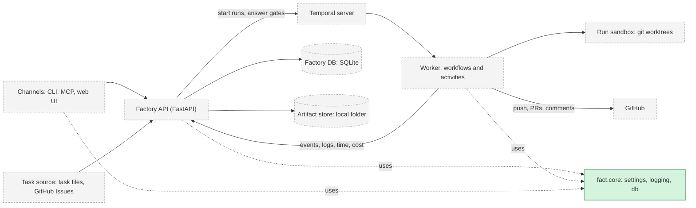
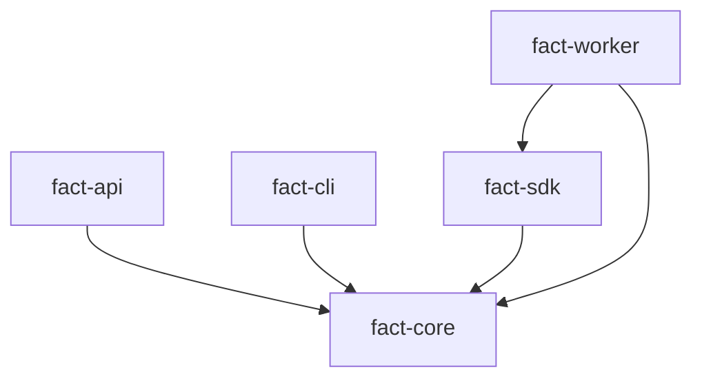

# Architecture

fact is a software factory: a service that turns tracker issues into reviewed GitHub PRs using coding agents, with Temporal running every workflow durably. The design source of truth is `docs/spec/` (start at `docs/spec/README.md`); this file is the index of what exists in code today and how it maps to the design.

**Status (M1 in progress).** `fact.core` has real code: settings (`@core/src/fact/core/settings.py`), structured logging (`@core/src/fact/core/logging.py`) and the async SQLAlchemy layer with Alembic migrations (`@core/src/fact/core/db.py`, `migrate.py`, `@core/migrations/`; schema in `models.py`). `fact.api` has a skeleton (M0-08, see below). `fact.worker` has a skeleton (M0-09): `python -m fact.worker` runs a worker on the `control` task queue with a ping workflow and activity (`client.py`, `ping.py`, `__main__.py`). `fact.cli` (M0-10) has the `fact` command: `fact dev` starts Temporal, the API and the worker; `fact projects list` reads the API; `fact github check` verifies GitHub App access. `fact.core.github` (M1-10) mints per-repository GitHub App installation tokens; the worker's `open_change_set` (M1-11) uses them to push the run's branch and open its PR. `fact.sdk` (M1-12) has the workflow base class `FactWorkflow` and the stage manifest; `.fact/workflows/standard.py` is the first project workflow (`Standard`). Since M1-13, `python -m fact.worker` loads each registered project's workflows from a pinned checkout of its home repository and runs them on a versioned `wf-<project>` worker (pinned runs). Since M1-14, `POST /api/v1/runs/start` starts a project's workflow for a task, and `fact run`, `fact runs` and `fact status` start and follow runs through the API. Since M1-15, `fact use <ref>` pins a checkout of the factory and `fact dev --pinned` runs the API and worker from it, so fact can work on itself (spec `14-dogfooding-and-safety.md`). Everything else below marked *planned* is specified in `docs/spec/` and tracked in `tasks/`, but not implemented.

## System Overview

Target architecture (from `docs/spec/04-architecture.md`). Solid boxes exist in code; dashed boxes are planned.

## Package Dependencies (from each `pyproject.toml`)

All packages share the `fact.*` namespace and are members of one uv workspace (`@pyproject.toml`). Dependencies point inward to `core`.

## Component Map

| Component | Path | State | Responsibility |
| --- | --- | --- | --- |
| fact.core | `@core/src/fact/core/` | Partial: `settings.py`, `logging.py`, `db.py`, `models.py`, `enums.py`, `migrate.py`, `migrations/`, `project_config.py`, `types.py`, `activity_contract.py`, `tasks/`, `artifacts.py`, `claude_usage.py`, `github/` | Settings loading, logging, async DB engine and Alembic, DB models (projects, repositories, runs, steps, events), status/outcome enums, the activity contract between `fact.sdk` and the worker (`activity_contract.py`: `CONTROL_QUEUE`/`SANDBOX_QUEUE`, `workflow_queue(project)` giving `wf-<project>`, activity names, activity input models), shared Temporal-boundary types (`Task`, `StepResult`, `RunInput` with `home_repo` and `limits: RunLimits`, `Route`, `RouteOverride`, ..., `limit_text`; frozen Pydantic models carrying `ArtifactRef`s, never raw logs), task files source (`FileTaskSource`), artifact store (`artifacts.py`: `ArtifactStore` protocol, `LocalArtifactStore` with atomic writes via `.tmp/`, `step_key`), Claude Code usage windows (`claude_usage.py`: `ClaudeUsage`/`UsageWindow` with `blocked(threshold)` and `resume_at(threshold)`, `fetch_claude_usage(token)` for the usage endpoint, `parse_rate_limit_info` for stream-json `rate_limit_event`s; the token is passed in, `read_cli_token()` is local-dev only), GitHub App access (`github/`, see below) |
| fact.api | `@api/src/fact/api/` | Partial: `app.py`, `projects.py`, `middleware.py`, `deps.py`, `schemas.py`, `run_schemas.py`, `run_totals.py`, `run_start.py`, `task_ref.py`, `temporal.py`, `routers/`, `__main__.py` | FastAPI app with `/health`, `/api/v1/projects`, the runs, steps and events API, and starting runs in Temporal (`POST /api/v1/runs/start`); later answer gates, logs and costs |
| fact.worker | `@worker/src/fact/worker/` | Partial | Temporal workers on the `control` and `sandbox` queues, plus one workflow worker per registered project on `wf-<project>` (M1-13): `loader.py` (`load_project`: syncs the home mirror, resolves the default-branch SHA, detached worktree at `pinned_dir/projects/<project>/<sha>`, imports `.fact/workflows/*.py` under unique module names `fact_workflows_<project>_<sha12>_<stem>` via a meta path finder; `sandbox_runner()` passes `fact`, `pydantic`, `pydantic_core`, `rich` through the sandbox; a project that fails to load is logged as `workflow_load_failed` and skipped) and `deployments.py` (Worker Deployment Versioning: deployment `wf-<project>`, build id `<factory SHA[:12]>+<home SHA>`, default behaviour `PINNED`, made current on start); the sandbox worker is capped at `concurrency.sandboxes` concurrent activities. Connect (Pydantic data converter), `PingWorkflow` and `ping` activity; `reporting.py` has `StepReporter`, the context manager activities use to report a step (creates the step, binds logs, uploads `output.log`, patches outcome and usage; API failures never fail the step); `runners/` has the `Runner` protocol (`base.py`: `prepare`, `exec`, `teardown`, `capabilities`; `ExecLine`/`ExecExit` stream items), `LocalWorktreeRunner` (`local_worktree.py`: `prepare` refuses a workspace inside `pinned_dir` or inside the running factory checkout (`factory_root`, default `REPO_ROOT`); bare mirror per repo at `repos_dir/<owner>/<repo>`, synced by the public `sync_mirror`, which also follows default-branch renames with `git remote set-head origin --auto`, one worktree per repo at `workspaces_dir/<run_id>/<repo name>`, `WORKSPACE.md`, commit author `fact[bot]` via `GitHubApp.bot_identity()` when the App is configured, else `commit_author_name`/`commit_author_email`; `core.bare` kept in the mirror's `config.worktree`) and `process.py` (minimal-env spawn, merged output, process-tree kill on timeout); `activities/workspace.py` (`prepare_workspace`, control queue), `activities/shell.py` (`shell_step`, runs `.fact/repo.yaml` lint/test commands from the worktree, heartbeats every 30 s, `passed`/`failed_checks`, on the new `sandbox` queue) and `activities/agent.py` (`agent_step`, sandbox queue, M1-09: routes harness and model, renders `.fact/prompts/<name>.md` from the home repo worktree, runs the harness at the workspace root, uploads the transcript, passes `step_defaults.agent.permission_mode` (default `auto`) and the prompt's output schema (`prompts.BASE_OUTPUT_SCHEMA` plus `.fact/prompts/<name>.schema.json`), and `judge`s the structured answer: `passed` for `status: done`, `needs_human` for `blocked`, `failed_error` without an answer, `stopped_by_monitor` at the turn limit; denied tool calls are logged and kept in `outputs.permission_denials`), `activities/change_set.py` (`open_change_set`, control queue, stage `open_pr`, M1-11: one repository in v0, pushes the run's branch with `git_push.py` and opens or reuses its PR with `pull_requests.py`, body from `pr_body.py` and `templates/pr_body.md`; returns `PRRef`s), `activities/control.py` (`ControlActivities`, control queue, M1-12: `mark_task_done` commits the task file's `status: done` on the run's branch, `record_run_started`/`record_run_finished` PATCH the run, `record_run_started` also `worker_version` and `home_sha`; not reported as steps); worker modules re-export the contract names from `fact.core.activity_contract`; `routing.py` (`choose`: per-field harness/model from override, then `routing.rules`, then `routing.default`); `prompts.py` (`string.Template` prompt rendering, `PromptError`); `python -m fact.worker` runs both activity queues and the project workflow workers, reaches the API at `settings.api_url`, and on Windows treats Ctrl-Break (SIGBREAK) like Ctrl-C so workers drain; it builds one `GitHubApp` per process when configured. Details in `@worker/README.md` |
| fact.worker harnesses | `@worker/src/fact/worker/harnesses/` | Partial: `base.py`, `claude_code.py`, `__main__.py` | Harness contract (`HarnessRequest` with `permission_mode` and `output_schema`, `HarnessResult` with `Usage`, `structured_output` and `permission_denials`, `Harness` protocol `run(request, transcript_path, on_message)`, `HarnessError`) and `ClaudeCodeHarness` (M1-08): runs `claude -p --output-format stream-json --verbose --permission-prompts none` (plus `--permission-mode`, `--json-schema` when set) with the prompt on stdin, writes every output line to the transcript, and reads the result from the final `result` message; spawned through `runners/process.py` (`spawn` options `pipe_stdin`, `merge_stderr`, `limit`). Called by `agent_step`; `python -m fact.worker` registers `ClaudeCodeHarness`. Details in `@worker/README.md` |
| fact.sdk | `@sdk/src/fact/sdk/` | Partial: `types.py` (re-exports `fact.core.types`, enums, `Check`, `CheckResult`), `workflow.py` | Workflow base class `FactWorkflow`, `Stage` and `@stages` for project workflows; calls activities by name, never imports `fact.worker`; see below |
| fact.cli | `@cli/src/fact/cli/` | Partial: `main.py`, `dev.py`, `use.py`, `projects.py`, `github.py`, `runs.py`, `supervisor.py` | The `fact` Typer command (script entry `fact.cli.main:app`): `--version`, `fact dev [--pinned]`, `fact use`, `fact projects list`, `fact github check`, `fact github labels sync`, `fact run`, `fact runs`, `fact status`; see below |
| web | `web/` | Absent | React UI, from M3 |
| `.fact/` | `.fact/` | Partial: `project.yaml`, `repo.yaml`, `workflows/` (`standard.py`, `README.md`), `prompts/` (`implement.md`, `fix_checks.md`, `README.md`) | fact's own project config, workflows and prompts; prompts are rendered by `agent_step` |
| fact.yaml | `@fact.yaml` | Exists | Global settings and project registry (one project: `fact`, home `Kahncode/fact`) |
| scripts | `scripts/` | Exists | Python helper scripts: `task_loop.py` runs `/next-task` in a loop and waits out usage windows with `fact.core.claude_usage`; `claude_run.py` invokes `claude -p` and logs each run as raw events (`.jsonl`) and a readable transcript (`.log`, formatted by `claude_log.py`) in `.tmp/task-loop/logs/`; `loop_report.py` prints why the loop stopped and what a person must do (tasks a run reported `BLOCKED:`, which are skipped rather than retried, and open `human_actions`); `loop_recovery.py` persists the task in progress (`.tmp/task-loop/state.json`), resumes it after a restart and reopens a task whose run hit the usage limit (see `docs/decisions.md`); `task_files.py` parses and orders tasks; tests in `scripts/tests/`. Every script is Python |
| Agent tooling | `.agents/` | Exists | Canonical skills (`.agents/skills/`) and subagent definitions (`.agents/agents/`); the SessionStart hook `@.claude/hooks/project_dot_agents.py` projects them into the gitignored `.claude/skills` and `.claude/agents` (see `docs/decisions.md`) |
| CI | `@.github/workflows/ci.yaml` | Exists | On push to main and PRs: `uv sync --locked`, ruff, black `--check`, pytest on ubuntu and windows |
| Work items | `tasks/` | Exists | One markdown file per task, grouped by milestone `M0`..`M2` so far, plus `backlog.md` |
| Design spec | `docs/spec/` | Exists | Design, one file per section |

## What exists in `fact.core`

**Settings** (`get_settings()`, frozen pydantic-settings `Settings`):

- Source priority, low to high: field defaults, `fact.yaml`, `fact.<env>.yaml`, `.env`, `FACT_*` env vars with `__` nesting.
- `FACT_CONFIG` relocates `fact.yaml`; `.env` is read from the same folder. `FACT_ENV` (`local`, `test`, `dev`, `prod`) selects the overlay file.
- `${VAR}` in YAML expands from the environment, else from the contents of a file at that path (mounted secret); unresolved references are left as written.
- Top-level keys: `env`, `log_level` (optional; `FACT_LOG_LEVEL`; one of DEBUG, INFO, WARNING, ERROR, CRITICAL, case-insensitive), `log_gcp` (bool), `data_dir`, `commit_author_name`, `commit_author_email`, `github_app_id` (str: App ID or Client ID; `FACT_GITHUB_APP_ID`), `github_app_private_key_path` (`FACT_GITHUB_APP_PRIVATE_KEY_PATH`), `github_api_url` (default `https://api.github.com`). `effective_log_level`: `log_level`, else DEBUG for `local`/`dev` and INFO for `test`/`prod`. `is_dev_environment()` is true for `local`, `test`, `dev`.
- Sections: `temporal` (address, namespace, `ui_url` for run links, default `http://localhost:8233`), `api` (host, port), `concurrency` (sandboxes, planners), `projects` (name, home, optional local path), `routing` (`default` `Route`, default `claude-code`/`sonnet`; `rules` keyed `<complexity|*>.<stage|*>`, each a `RouteOverride`), `step_defaults` (typed per kind: `agent` 60 min, `max_turns` 100 and `permission_mode` `auto`, `shell` 15 min; other kinds get `StepDefaults()`; read with `Settings.step_default(kind)`; `timeout_minutes` is not applied yet). Derived paths under `data_dir` (default `~/.fact`): `fact.db`, `temporal.db`, `artifacts/`, `workspaces/`, `repos/`, `pinned/`.
- `api_url` is the base URL clients (worker, CLI) use to reach the API: `http://<api.host>:<api.port>`, with wildcard bind hosts `0.0.0.0` and `::` mapped to `127.0.0.1` and `::1`, and IPv6 literals bracketed.
- `override_settings_class()` lets an app load a `Settings` subclass once, before first use; `reset_settings()` is for tests.

**Logging** (structlog over stdlib logging):

- `configure_logging(env, level, *, gcp=False, extra_processors=())` once at process start (the API calls it in `create_app`); console renderer for `local`/`test` (colored when stdout is a TTY), JSON otherwise, to stdout. Safe to call again; the last call wins.
- JSON lines add the call site (file, function, line), decode bytes, and honor level filtering (`filter_by_level`). With `gcp=True`, `format_gcloud_logs` (`@core/src/fact/core/logging_gcp.py`) renames `event`/`level` to `message`/`severity` and folds `http_request`/`http_response` into `httpRequest` (method, url, status, latency, user agent, request size); bodies, query and headers stay as top-level `request_body`, `response_body`, `request_query` and `request_headers`.
- stdlib records (uvicorn, temporalio) pass through the same processors.
- `bind_run(run_id, step_id)` context manager binds ids to every line in scope.

**Database** (`db.py`, `migrate.py`, `core/migrations/`; see `@core/README.md`):

- `Base` with a constraint naming convention, `database_url(settings)`, `create_engine(url)` (pragmas `foreign_keys=ON`, `journal_mode=WAL`), `session_factory(engine)`.
- `models.py`: `Project`, `Repository`, `Run`, `Step`, `Event` (typed `Mapped[...]`, portable types only; enums in `enums.py` stored as strings). Run and step ids are uuid4 hex strings, the others integers. One initial Alembic revision creates them.
- Alembic with an async `env.py` (URL from settings, `render_as_batch=True`); `migrate.upgrade(url)` runs `upgrade head` in code and creates a missing data dir.

**Project config** (`project_config.py`; fact's own files are in `@.fact/`):

- `load_project_config(home_path)` reads `<home>/.fact/project.yaml` into `ProjectConfig` (name, repositories, task source, runner pool, budget, merge policy, plan approval, workflows map with `default`); `load_repo_config(repo_path)` reads `.fact/repo.yaml` into `RepoConfig` (`setup`, `lint`, `test`, `build`, each a list of argv lists).
- Models are frozen and reject unknown keys; failures raise `ConfigError` naming the file and field.

**Task files** (`@core/src/fact/core/tasks/files.py`; tests in `@core/tests/test_task_files.py`):

- `FileTaskSource(root, folder="tasks")` reads `tasks/<milestone>/<NN>-<slug>.md` into `Task` models. Methods: `all()`, `get(key)`, `status(key)`, `deps_done(task)`, `ready()`, `validate() -> list[str]`, `mark_done(worktree, key)`. `branch_name(key)` gives the task branch name.
- Statuses are not on the `Task` model; read them with `status(key)`. `mark_done` rewrites only the status value inside the front matter, leaving every other byte unchanged.
- A dependency whose file is missing counts as done if its number is below the highest remaining task in its milestone, or its milestone is below the highest milestone present. `validate()` therefore accepts such ids and cannot catch typos below that bound; an id above it (M1-99 when M1-19 is highest) is an error.
- `validate()` on the real `tasks/` folder runs as a test in CI.

**GitHub App** (`@core/src/fact/core/github/`: `app.py`, `client.py`, `labels.py`; details in `@core/README.md`; dependencies `pyjwt[crypto]`, `httpx`):

- `GitHubApp(app_id, private_key, *, api_url, transport, clock)`; `from_settings()` raises `GitHubAppConfigError` if unset and resolves a relative key path from the folder of `fact.yaml`. `app_jwt()` signs RS256 (iat now-60 s, exp now+9 min). `installation_token(owner/repo)` mints a token scoped to that one repository, cached per repository until 5 minutes before expiry, minted once under concurrency. `bot_identity()` gives `<slug>[bot]` and its noreply email. Caches are per instance: one `GitHubApp` per process.
- `github_client(token, *, api_url)` (or `GitHubApp.api_client(token)` on the App's API URL): `httpx.AsyncClient` with bearer auth and GitHub API headers; errors raise `GitHubAuthError` (401), `GitHubForbiddenError` (403), `GitHubNotFoundError` (404) or `GitHubError`, never carrying headers. Tokens never appear in logs or `repr()`.
- `labels.py`: `FACT_LABELS` (the `fact:*`, `type:*` and `complexity:*` labels from `docs/spec/12-integrations.md`, each a `Label(name, color, description)`) and `sync_labels(client, owner/repo)`, which creates missing labels and fixes colour, description and case of existing ones (names match case-insensitively), never deletes, and returns a `LabelChange` (created, updated, unchanged) per label. `split_full_name(owner/repo)` (in `app.py`) validates and splits a repository name.
- Used by the worker: `LocalWorktreeRunner` commits as `bot_identity()`, and `open_change_set` pushes and opens PRs with installation tokens (see `@worker/README.md`).

## What exists in `fact.api`

- `create_app(settings=None)` (`@api/src/fact/api/app.py`) builds the FastAPI app. Its lifespan configures logging, runs `migrate.upgrade` in a thread (it starts its own event loop), creates the engine and session factory on `app.state` (`settings`, `engine`, `sessions`), calls `sync_projects`, and disposes the engine on shutdown.
- `sync_projects` (`@api/src/fact/api/projects.py`) upserts each `fact.yaml` project and the repositories from its `.fact/project.yaml` into the DB. It is idempotent and never deletes rows. An invalid or missing `project.yaml` raises `ConfigError` and the API fails to start. A relative project `path` in `fact.yaml` resolves against the folder of `fact.yaml`; a project without `path` gets no repositories.
- Routes: `GET /health` and `GET /api/v1/projects` (`routers/health.py`, `routers/projects.py`; response models in `schemas.py`, dependencies in `deps.py`).
- Runs API (`routers/runs.py`; models in `run_schemas.py`), all under `/api/v1`:
  - `POST /runs` (by project name), `PATCH /runs/{id}`, `GET /runs` (filters `project`, `status`, `task_key`, `workflow_id`; newest first), `GET /runs/{id}` (run plus steps ordered by queued, started, stage, attempt).
  - `POST /runs/{id}/steps`, `PATCH /steps/{id}`, `POST /runs/{id}/events` (batch; a `step_id` must belong to the run).
  - 404 for an unknown run, step or project; 409 for a duplicate `workflow_id` or duplicate step (run, stage, attempt). A new step is `running` if `started_at` is set, else `queued`.
  - In PATCH bodies an explicit `null` is ignored for NOT NULL columns; only nullable ones (outcome, timestamps, refs, step outputs) can be cleared.
  - `recompute_totals` (`run_totals.py`) runs on every step PATCH and recomputes the run's `machine_seconds` (step wall time minus `wait_seconds`), `human_wait_seconds`, tokens and `cost_usd` from finished steps only.
- Starting a run (`routers/run_start.py`, `run_start.py`, `task_ref.py`, `temporal.py`): `POST /api/v1/runs/start` with `task_key`, optional `project` and `override_deps`.
  - Finds the project: the one given, else every project with a local `path` whose task source is `files` (a broken project is skipped with a warning while searching; several matches is 409).
  - Runs `git fetch origin <default branch>` (`GIT_TERMINAL_PROMPT=0`; on failure the last fetched state is used) and reads the task folder from `origin/<default branch>` with `git archive` into a temp dir, read by `FileTaskSource`. Unfinished dependencies give 409 with `detail.missing_deps` unless `override_deps`.
  - Workflow type is `workflows.<task type>` from `project.yaml`, else `workflows.default`. Workflow id is `run-<task key, unsafe characters as '-'>-<n>` (e.g. `run-task-M1-02-1`), `n` one past the highest used for that task.
  - Inserts the run as `queued`, then starts the workflow on `wf-<project>` with a `RunInput` (repos by `merge_order`, branch `fact/task-<id, lowercased>` from `branch_name`, task complexity, `limits` from `step_defaults`, `run_url` = the Temporal UI link, shown in the PR body). A failed start keeps the row as `finished`/`failed`; `WorkflowAlreadyStartedError` moves to the next `n` (see `docs/decisions.md`).
  - Returns `run_id`, `workflow_id`, `workflow_type`, `project`, `temporal_url` (`<temporal.ui_url>/namespaces/<ns>/workflows/<id>`).
  - The Temporal client (`app.state.temporal`, a `TemporalConnection`) connects on first use, so the API starts while Temporal is down; an unreachable Temporal is 503, a refused start 502. Refusals (unknown task, missing deps) need no Temporal.
- `RequestIdMiddleware` (`middleware.py`, pure ASGI) sets or propagates the `X-Request-ID` header (a supplied value must match `[A-Za-z0-9._-]{1,128}`, else a new UUID in dashed form), binds `request_id` in structlog and logs one `request_completed` line per request: method, path, query, headers without credentials, status, latency, and JSON request and response bodies up to 8 KiB with secret-looking keys masked (`body_capture.py`); `/health` is skipped. Header values, query parameters and JSON keys that look secret are replaced by `***` (`is_secret_key` in `body_capture.py`: a name word of password, secret, token, authorization, credential, signature or cookie, or containing `api_key` or `private_key`; `input_tokens` is not masked). A request cancelled before a response is logged as 499. `unhandled_exception_handler` returns a JSON 500 with `request_id` (plus `detail` only in local and test) and logs it with the id passed explicitly, because it runs outside the middleware.
- Logging is configured in `create_app` (before the app is built) from `settings.env`, `settings.effective_log_level` (`FACT_LOG_LEVEL`; default DEBUG in local and dev, INFO elsewhere) and `settings.log_gcp` (Cloud Logging fields: `message`, `severity`, `httpRequest`; `core/src/fact/core/logging_gcp.py`). `python -m fact.api` runs uvicorn with `log_config=None` and `access_log=False` so its lines go through structlog. JSON lines carry the call site.
- `@api/tests/test_routes.py` fails when a route is missing from `TESTED_ROUTES` or lists a test that does not exist; add every new route there.
- Run with `uv run python -m fact.api`: uvicorn on `settings.api.host` and `settings.api.port`. Tests: `@api/tests/test_app.py`, `@api/tests/test_runs.py`, `@api/tests/test_run_start.py`; shared fixtures in `@api/tests/conftest.py`.

## What exists in `fact.sdk` and `.fact/workflows/`

- `@sdk/src/fact/sdk/workflow.py`: `Stage(id, label, kind, loops_to=None)` and the `@stages([...])` class decorator (rejects duplicate ids and unknown `loops_to`), stored as `stage_manifest`; `manifest()` returns plain dicts for the UI.
- `FactWorkflow` helpers: `execute(run_input, body)` records the run started (with the build id from `workflow.info().get_current_deployment_version()` as `worker_version`) and finished (best effort; `failed` when `body` raises a Temporal failure), `prepare()`, `agent(stage_id, prompt, context)`, `until_green(checks, fix_prompt, max_attempts, stage_id="checks", fix_stage="implement")`, `mark_task_done()`, `open_change_set(title, summary)`, `pr_text()` (agent-written `title`/`summary` outputs, else a conventional title from the task).
- `until_green`: `max_attempts` caps fix sessions, so checks run at most `max_attempts + 1` times; it stops early when a fix session does not pass. Fix sessions are new attempts of `fix_stage`. Attempt numbers are per stage; each shell step in `checks` takes the next one.
- Retries: agent steps never retry (`NO_RETRY`); shell and control steps use `INFRA_RETRY` (5 attempts). Timeouts come from `RunInput.limits`, filled by whoever starts the run; workflow code reads no settings.
- `@.fact/workflows/standard.py`: `Standard` (Temporal type `standard`), stages `prepare`, `implement`, `checks` (loops to `implement`), `open_pr`. Outcomes: implement not passing is `failed`; checks still failing after 3 fix sessions is `needs_human` with no PR; green marks the task done and opens the PR (`pr_opened`).
- Tests: `@worker/tests/test_standard_workflow.py` runs `Standard` in a time-skipping environment against fake activities registered under the real names, and replays `@worker/tests/histories/standard_green.json`. Re-record with `FACT_RECORD_HISTORIES=1 uv run pytest worker/tests/test_standard_workflow.py`.

## What exists in `fact.cli`

- `fact` (`@cli/src/fact/cli/main.py`): Typer app with `--version`, the `dev` and `use` commands and the `projects` and `github` groups. Dependencies: `typer`, `httpx`.
- `fact github check <owner/repo>` (`github.py`): configures logging at WARNING, mints an installation token through `GitHubApp.from_settings()` and prints the app slug and id, installation id and account, and token expiry, never the token. Exits 1 with a readable error on a `GitHubError`, a bad name, a network failure or a 2xx response with an unexpected body (`error: unexpected GitHub response (missing ...)`). `make_app()` is the test seam.
- `fact github labels sync <owner/repo>` (`github.py`): runs `sync_labels` with an installation token for that repository and prints one line per label (`created`, `updated` or `unchanged`) and a summary (`<n> of <total> labels changed on <owner/repo>`); same error handling as `check`.
- `fact projects list` (`projects.py`): `GET /api/v1/projects` at `settings.api_url`, printed as a `NAME`/`HOME`/`REPOSITORIES` table; exits 1 with a message when the API is unreachable or answers an error. `make_client()` is the seam tests replace with an `httpx.MockTransport` client.
- `fact run <task_key> [--force-deps] [--project]`, `fact runs [--project] [--status]` and `fact status <run id | workflow id>` (`runs.py`) call the runs API at `settings.api_url`. `run` prints the workflow id, run id and Temporal UI link, and names missing dependencies on a 409; `runs` prints a table, newest first; `status` resolves a `run-...` id through `GET /runs?workflow_id=`, then prints the run and its steps with durations, outcome, cost and artifact links for logs and transcripts.
- `fact dev` (`dev.py`): fails with an install hint if `temporal` is not on PATH, creates `data_dir`, then starts, in order: `temporal server start-dev --db-filename <data_dir>/temporal.db --port <port of temporal.address> --ui-port 8233`, `python -m fact.api`, and `python -m fact.worker` (started only once Temporal's port accepts connections, 60 s timeout). Exit code is 0 on Ctrl-C, else the first child's exit code. With `--pinned`, Temporal runs as before but the API and worker run from the pinned version as `uv run --frozen --project <checkout> python -m fact.api|fact.worker`, with `FACT_CONFIG` set to the source tree's `fact.yaml` so the pinned checkout reads the same config and `.env`; it exits 1 if nothing is pinned or `uv` is not on PATH.
- `fact use <ref>` (`use.py`): runs `git fetch --prune origin` in the factory source tree, resolves `origin/<ref>` first, then `<ref>` (`HEAD` always means the local HEAD), creates a detached worktree at `<data_dir>/pinned/factory/<sha>` (reused when already at that SHA, recreated when broken), runs `uv sync --locked` in it and writes the SHA to `<data_dir>/pinned/current`. `current_pin(settings)` reads it back for `fact dev --pinned`.
- `supervisor.py` (generic, `run_all(specs)`; each `ChildSpec` may carry an `env` dict of extra variables): each output line is prefixed with the process name. When a child exits (`fact | <name> exited with code N`) or on a stop signal (SIGINT, SIGTERM, plus SIGBREAK on Windows or SIGHUP on POSIX), it stops the children one at a time, last started first, escalating interrupt, terminate, kill with 10 s per step; further stop signals are ignored meanwhile. Each child runs in its own process group (Windows; interrupt is `CTRL_BREAK_EVENT`) or session (POSIX; signals go to the group via `killpg`).

## Technology Choices

Implemented choices are in effect now; the rest are specified in `docs/spec/13-storage-and-stack.md` and not yet in code.

| Choice | Why | State |
| --- | --- | --- |
| Python 3.15, uv workspace | One lockfile; namespace packages `fact.*`; hatchling builds each package | In use |
| pydantic-settings + `fact.yaml` | Layered config with `FACT_*` overrides; frozen settings avoid mutation after load | In use |
| structlog | One `run_id` on every line, including third-party stdlib logs | In use |
| ruff (`select = ALL`), black (120), pre-commit | Enforced style; CI runs ruff, black and pytest on Linux and Windows | In use |
| pytest, pytest-asyncio (auto) | Per-package `tests/` | In use |
| Temporal | Durable workflows; deterministic workflow code, side effects only in activities | In use (dev server via `fact dev`; worker on `control` and `sandbox` queues and per-project `wf-<project>` queues with Worker Deployment Versioning, pinned) |
| FastAPI, Pydantic v2 | Plain routers, typed models | In use (health, projects, runs, artifacts, run start) |
| SQLAlchemy 2 async + Alembic, SQLite (aiosqlite) | Standard ORM, Postgres-compatible types so moving to Supabase is a connection string | In use (engine and migrations; schema in `models.py`) |
| Artifact store with local-folder backend | Logs, transcripts and diffs stay out of Temporal payloads and the DB; Temporal carries references | Done (`PUT`/`GET /api/v1/artifacts/{key}`) |
| Typer, httpx | `fact` command; calls the API over HTTP | In use (`dev`, `use`, `projects list`, `github check`, `github labels sync`, `run`, `runs`, `status`) |
| GitHub App (PyJWT RS256, httpx) | PRs and comments authored by `fact[bot]`; short-lived installation tokens scoped to one repository instead of a personal token | In use (`fact.core.github`, M1-10); the worker commits as `fact[bot]` and pushes and opens PRs (M1-11) |
| React + Vite, TanStack, React Flow, SSE | UI for runs and live logs | Planned (M3) |
| Claude Code and Codex CLIs as harnesses; `git worktree` runners; `gh` for GitHub | Agents run as subprocesses in isolated workspaces | Partial: `local-worktree` runner, Claude Code adapter and `agent_step` built (M1-06, M1-08, M1-09); Codex and `gh` planned |

Cross-platform rule: every script is Python; `pathlib` and argument-list subprocesses; no bash, make, `.sh` or `.bat`.

## Local Process Model

Three local processes: Temporal dev server, the API, and the worker, with two SQLite files (`fact.db`, `temporal.db`) under `data_dir`. `uv run fact dev` starts and supervises them (see `fact.cli` above); the Temporal UI is on port 8233. `uv run fact dev --pinned` runs the API and worker from the pinned checkout under `<data_dir>/pinned/factory/<sha>` instead of the source tree, so agents editing fact never edit the running factory. See `docs/spec/04-architecture.md`.

## Milestones

M0 Skeleton, M1 First run, M2 Issues and gates, M3 UI, M4 Loops and multi-repo, M5 Planner, M6 Hardening. Detail in `docs/spec/15-milestones.md`; task files in `tasks/M0` to `tasks/M2`. Git history shows M0-03 (settings) and M0-04 (logging) done.

## Subsystem Links

No `docs/<subsystem>.md` deep-dive files exist yet. Design documentation lives in the spec:

| Topic | Doc |
| --- | --- |
| Spec index | `docs/spec/README.md` |
| Three processes and how they talk | `docs/spec/04-architecture.md` |
| Temporal usage | `docs/spec/03-temporal.md` |
| Domain model | `docs/spec/05-domain-model.md` |
| Workflow authoring, `.fact/` | `docs/spec/06-workflow-authoring.md` |
| Runners and harnesses | `docs/spec/09-runners-and-harnesses.md` |
| Observability, artifacts | `docs/spec/10-observability.md` |
| Storage and stack | `docs/spec/13-storage-and-stack.md` |
| Dogfooding and safety, pinned checkout | `docs/spec/14-dogfooding-and-safety.md` |
| Milestones | `docs/spec/15-milestones.md` |
| Decisions and open questions (design) | `docs/spec/16-decisions.md` |
| Implementation decisions log, open items | `docs/decisions.md` |
