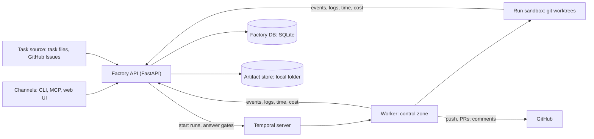

# Architecture

Channels reach the factory API, which starts runs and answers gates through Temporal. The worker runs each step in the run's workspace and pushes PRs to GitHub, and every step reports its logs, time and cost back to the API, which stores them.
