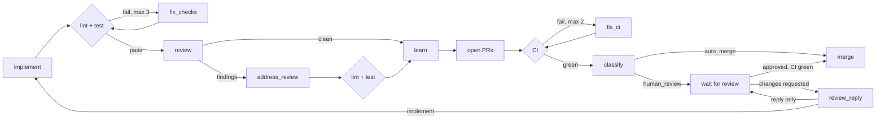

# Reference workflow: issue to PRs

The standard workflow is code, lint and test, agent review, classify, then PRs. Every failure before the PR and every CI failure starts a new agent session in the run's sandbox. Merging needs no agent: it is automatic or yours, depending on the classification. It starts once the Planning phase has produced an approved plan; incident workflows can add a preview deploy on the same base.

**Review follows GitHub's review flow (decided 27 Nov 2026).** A PR routed `human_review` waits for its reviewer, read from GitHub (polled every 60 s until webhooks):

- **Only maintainers count (decided 27 Nov 2026)**: fact acts on a review or a comment only when its author has `write`, `maintain` or `admin` permission on the repository (`GET /repos/{owner}/{repo}/collaborators/{username}/permission`). On a public repository any GitHub account can approve, request changes or comment; GitHub shows such a review as non-binding, but the reviews API lists it like any other. Everything else is ignored, never handled and never passed to a session, as if it did not exist. Bots, fact's own replies among them, never count either. The same rule holds for every comment fact reads, on a PR or an issue (the `answer` mentions below included).
  - fact tells the outsider, once per action: each review or comment by a non-maintainer that fact sees (a review or comment on a PR it waits on, a comment mentioning the App on an issue) gets one reply from `fact[bot]`, saying that only people with write access to the repository can steer fact and that it was not taken into account. A review or a conversation comment gets a PR or issue comment that links it; an inline review comment gets a reply in its thread. A hidden marker per action (`<!-- fact:ignored <id> -->`) keeps it to one reply across polls, retries and restarts. No agent writes it, it wakes no run and notifies no one.
- **Approved**: an `APPROVED` review on the PR's head commit, by a maintainer. Once CI is green on that commit, fact merges the PR with the project's `merge_method`, whatever the project's `auto_merge` says: an approved PR is a *reviewed merge*, not an auto-merge. An approval on an older commit does not count; a push (a CI fix, a base sync, the reviewer's own) needs a new approval.
- **Changes requested**: each new `CHANGES_REQUESTED` review by a maintainer is handled once, as a whole. One `review_reply` session reads that review's body and comments, and every other maintainer comment on the PR since fact last pushed, mention or not (the whole review is for fact, unlike an issue, where only comments mentioning the App answer), and replies to each one: it acknowledges, pushes back with reasons, or asks for more. fact posts the replies as `fact[bot]` in their threads (the session holds no GitHub token) and never resolves a thread; that is the reviewer's call. The session then answers `implement`, with instructions, or `reply`, when nothing needs to change. `implement` sends the run back through the whole chain with the review as its steering: implement, checks, agent review, learn, push, CI. `reply` changes nothing. Either way fact then re-requests a review from whoever requested changes, and the PR waits again. A reviewer who accepts the push-back simply approves.
- `COMMENTED` reviews and plain comments start nothing on their own; the next `CHANGES_REQUESTED` review takes them in.
- A PR that went through a review round stays `fact:needs-review` and is never classified again: only an approval merges it.
- A person may also merge or close the PR themselves.

Each PR of a change set lives its own life: it is merged as soon as it is approved and green, independently of the others. The run, and the task's closure, wait for every PR: the run ends once each one is merged or closed (`merged` if all were merged, else `closed`), within the 30-day review timeout.

**Multi-repository review is not designed yet.** The review loop assumes one repository. Open: whether several PRs with changes requested share one `review_reply` session (the shared workspace suggests yes), and what a session does when the review of one PR needs a change in a repository whose PR is already merged (today it must not: it answers `blocked`; later it may open a new PR that joins the change set).

**Asking on the task (decided 27 Nov 2026).** A person is asked on the task itself, never only in fact:

- An agent that is `blocked` because it needs information gives a `question` in its structured answer. fact posts it on the issue, saying to answer by mentioning the App, adds `fact:needs-human` and opens a gate. Only comments that mention the GitHub App (`@sofact-dev`; `fact` is taken on GitHub) answer it, so people can discuss on the issue without waking the run: each new mentioning comment from a maintainer goes to an `answer` session, which reads the question and the mentioning comments since the gate opened and decides: `continue` resumes the blocked session with its instructions and removes `fact:needs-human`; `ask` replies on the issue and keeps waiting; `stop` ends the run `needs_human`. A `blocked` answer without a `question` ends the run `needs_human`.
- A loop that runs out of attempts (checks, base sync, CI) ends the run `needs_human` and opens no gate; the run-end hold comments why on the issue.
- `fact gate approve|reject` still answers any gate and wins over the conversation; it is the only way to answer for file tasks, which have no issue. The UI replaces it.
- `review_reply` and `answer` are one library step, `converse`: collect the maintainers' comments on an issue or PR since a point (bots and people without write access left out), run a read-only session with a prompt, post the replies it wrote and return its decision.
- `approve_plan` is unchanged until the planner (M6) designs it.

Mentions of the App that start a session outside a review (a mention on a PR or an issue at any time) come later, with webhooks.
