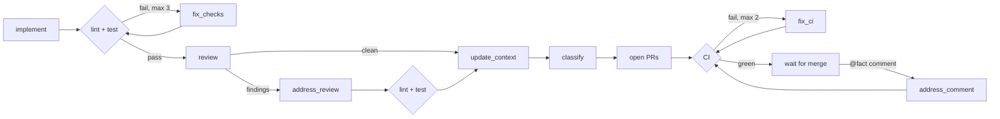

# Reference workflow: issue to PRs

The standard workflow is code, lint and test, agent review, classify, then PRs. Every failure before the PR, every CI failure and every `@fact` comment starts a new agent session in the run's sandbox. Merging needs no agent: it is automatic or yours, depending on the classification. It starts once the Planning phase has produced an approved plan; incident workflows can add a preview deploy on the same base.
