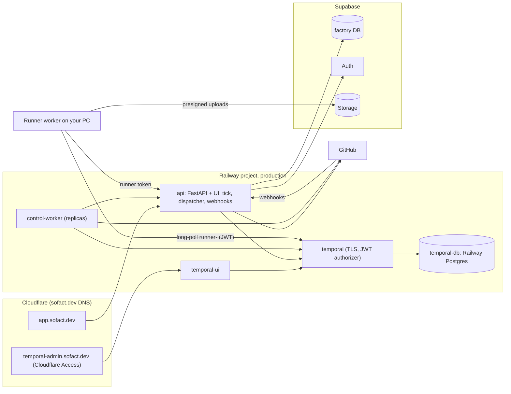

# Cloud deployment, runners and auth (M5)

M5 runs fact's control plane in the cloud while runners stay wherever the compute is (in M5, your PC). Local `fact dev` keeps working with no cloud at all, and runs the same split.

## What runs where

| Piece | Where | Notes |
| --- | --- | --- |
| `api` | Railway service, `app.sofact.dev` (proxied by Cloudflare) | FastAPI serving the built UI; the scheduler tick, the queue dispatcher (M5.3) and the GitHub webhook endpoint; migrations as its pre-deploy command. One replica until the tick and dispatcher run under a Postgres advisory lock |
| `control-worker` | Railway service, private | Workflow code and control activities only (below); stateless, scaled by replicas. Clones the projects' home repositories it loads workflows from into its ephemeral disk at start |
| `temporal` | Railway service, `temporal.sofact.dev` (DNS-only to Railway's TCP proxy: Cloudflare's proxy does not pass raw TCP) | Self-hosted Temporal server, frontend over TLS with Temporal's JWT authorizer; one namespace in M5 |
| `temporal-db` | Railway Postgres, private, backups on | Temporal's own database, nothing else uses it |
| `temporal-ui` | Railway service, `temporal-admin.sofact.dev` behind Cloudflare Access | Admins only (GitHub or one-time email code, an email allowlist) |
| Factory DB, Auth, Storage | Supabase (Pro) | Reached through Supabase's pooler in session mode (Railway has no outbound IPv6, Supabase's direct connection is IPv6 only) |
| Email | Resend | Supabase Auth's emails in M5; notification email waits for user accounts |
| Runner worker | Your PC (`fact runner`) | Workspaces, agents, checks; your Claude Code login |

Dockerfiles and `railway.toml` live in the repository. The first deploy is by hand; deploying `main` from CI, and upgrades that wait for or drain active runs, are stretch work.

**Temporal's database is operational state, not the record.** It holds every open workflow (histories, timers, signals, gates), so losing it loses every run in flight: it is backed up. A closed workflow is kept for the namespace retention (14 days) and then deleted. fact's own database holds what is kept about runs (runs, steps, costs, outputs); nothing reads Temporal for history or reporting. A waiting workflow holds no worker: its state is in that database, and any worker on its queue resumes it by replaying its history.

## Control and runners

**The control worker does no compute.** It runs workflow tasks and light I/O: the GitHub API (PRs, labels, comments, merges), the factory API and database, notifications. Everything that touches a workspace runs on a runner: preparing and tearing down workspaces, git (commit, push, the diff for classify signals), checks, agent sessions (classify included), transcripts. Activities are routed by the queue in their spec: control activities on the control queue, runner activities on `runner-<pool>`.

**A run sticks to one runner machine.** A `local-worktree` workspace is on one disk, so once `prepare_workspace` lands on a machine, every later runner activity of the run goes to that machine's own queue (`runner-<pool>-<machine id>`) until teardown. A machine that disappears times its activities out and the run ends `needs_human` until workspace recovery exists (`tasks/backlog.md`, Distributed runs).

**How a runner connects.** A runner opens outbound connections only, like a GitHub self-hosted runner, so it works behind NAT on any infrastructure:

- It authenticates to the API with a **runner token** and exchanges it for a short-lived **Temporal JWT** that fact's API issues (fact publishes its JWKS; Temporal's built-in JWT claim mapper and authorizer verify it). The JWT carries `<namespace>:worker`: poll and complete tasks, never start, signal or terminate workflows. The runner refreshes it before it expires.
- It long-polls its pool's queues on `temporal.sofact.dev` over TLS. Temporal keeps retries, heartbeats, timeouts and cancellation.
- Later, with organizations (M5.2), each organization gets its own namespace, so a customer's runner can only ever see its organization's work.
- A Daytona pool needs none of this: it is a worker the factory hosts (its own service, not the control worker) that drives sandboxes through Daytona's API. Self-hosted connectivity is for machines the factory cannot host.

The first M5 task is a spike: the Temporal server image with the default JWT claim mapper and authorizer enabled from config, TLS on the frontend (the certificate for `temporal.sofact.dev`: Let's Encrypt by DNS-01 through Cloudflare, or a private CA the runner pins), and a Python worker polling through it.

**Credentials stay where they belong.**

- The GitHub App private key lives only in the cloud. A runner asks the API for an installation token narrowed to the run's repositories and `contents: write`, granted only for an active run assigned to its pool. Tokens never travel in a Temporal payload.
- Artifacts (logs, transcripts) go straight from the runner to storage through presigned upload URLs the API issues for the runner's own runs: no storage credentials on the runner, no bytes through the API. Locally the same calls hit the local artifact store.
- A pool brings its own harness credentials. In M5 that is the Claude Code login (or `setup-token`) on your PC; other providers' keys come with other harnesses.
- Cloud secrets (App key, database URLs, session and token signing keys, Temporal certificates) are Railway service variables until the secret-store design; the runner's are in its `.env`.

**Usage limits belong to the runner.** The runner reads its account's usage windows and reports them to the API on an interval and after every agent step. When a window is inside the reserve, the runner stops polling (it advertises no slots) until the reset and reports "paused until" so the UI can say why. The factory has no usage gate: it only sees a pool's live capacity, and with none, work for that pool waits. A session that hits the limit mid-run keeps the `rate_limited` pause and resume (`10-observability.md`).

**Local dev runs the same split.** `fact dev` starts a control worker and a runner worker as two processes, with SQLite, the local artifact folder and the Temporal dev server, and the local auth provider below. Nothing in the split is exercised only in the cloud.

## Auth

The deployment is on the public internet and runs code on your machine, so every route is authenticated, deny by default. Each route declares exactly one class:

| Class | Who | Credential |
| --- | --- | --- |
| `user` | A person signed in to the UI or CLI | Supabase Auth JWT, verified against Supabase's JWKS |
| `runner` | A runner worker | Runner token: only runner routes, only its own pool's runs |
| `service` | Internal callers (the control worker, other factory services) | Service token |
| `webhook` | GitHub | The App's webhook HMAC signature |
| `public` | Anyone | `/health` only |

- **Accounts are created only on the Supabase dashboard.** Sign-ups are off in Supabase Auth, so the accounts that exist are the allowlist; people sign in with GitHub or an email link. The UI never creates accounts, even after organizations (M5.2), until a sign-up flow is released. In M5 every account is an admin.
- **Tokens** (runner, service, CLI) are random, stored hashed, scoped and revocable, sent as Bearer tokens. The first is created with a CLI command against the deployed database; later ones from the UI or CLI.
- **Tests guard it:** a test enumerates every route of the app and fails on a route with no class, and on any route that answers anything but 401/403 with missing, wrong or wrong-class credentials.
- **Local dev** runs the same checks against a local provider: `fact dev` generates a token in `data_dir` and gives it to the UI, CLI and workers. Auth is never switched off, and local dev needs no Supabase.
- **Admins reach Temporal** through the Temporal UI behind Cloudflare Access, or the `temporal` CLI with an admin JWT. Neither is public.

## Webhooks

Once hosted, the GitHub App's webhook is on, pointed at the API. Webhooks wake things up; GitHub stays the state:

- A delivery is verified (HMAC) and stored by its `X-GitHub-Delivery` id, so a duplicate does nothing.
- Issue events (opened, labelled, sub-issues) trigger a tick. PR reviews, comments and check-suite completions signal the waiting run to read GitHub now.
- Polling stays as a slow fallback (every 5 minutes), so a lost delivery only delays.
- Local dev keeps today's short polling (a smee.io channel can forward deliveries if wanted).
